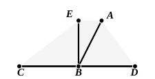

that side.” If it is not desired to trespass on that side of $AB$, we can take $D$ anywhere on $AB$ and describe the arc of a circle between $D$ and the point where it meets $AB$ again, drawing the arc on the side of $AB$ on which $C$ is. If it should happen that the selected point $D$ is such that the circle only meets $AB$ in *one* point ($D$ itself), we have only to describe the circle with $CD$ as radius, then, if $E$ be a point on this circle, take $F$ a point further from $C$ than $E$ is, and describe with $CF$ as radius the circular arc meeting $AB$ in two points.

### PROPOSITION 13.

If a straight line set up on a straight line make angles, it will make either two right angles or angles equal to two right angles.

For let any straight line $AB$ set up on the straight line  
5 $CD$ make the angles $CBA$, $ABD$;  
I say that the angles $CBA$, $ABD$ are either two right angles or equal to two right angles.

Now, if the angle $CBA$ is equal to  
10 the angle $ABD$,  

they are two right angles. [Def. 10]

But, if not, let $BE$ be drawn from the point $B$ at right  
angles to $CD$; [I. 11]  

therefore the angles $CBE$, $EBD$ are two right angles.

15 Then, since the angle $CBE$ is equal to the two angles  
$CBA$, $ABE$,  

let the angle $EBD$ be added to each;

therefore the angles $CBE$, $EBD$ are equal to the three angles $CBA$, $ABE$, $EBD$. [C. N. 2]

20 Again, since the angle $DBA$ is equal to the two angles  
$DBE$, $EBA$,  

let the angle $ABC$ be added to each;

therefore the angles $DBA$, $ABC$ are equal to the three angles $DBE$, $EBA$, $ABC$. [C. N. 2]

25 But the angles $CBE$, $EBD$ were also proved equal to  
the same three angles;  
and things which are equal to the same thing are also  
equal to one another; [C. N. 1]  

therefore the angles $CBE$, $EBD$ are also equal to the 30 angles $DBA$, $ABC$.

