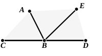

But the angles $CBE$, $EBD$ are two right angles;  

therefore the angles $DBA$, $ABC$ are also equal to two right angles.

Therefore etc.

Q. E. D.

---

**17. let the angle $EBD$ be added to each**, literally “let the angle $EBD$ be added (so as to be) common,” κοινὴ προσκείσθω ἡ ὑπὸ ΕΒΔ. Similarly κοινὴ ἀφηρήσθω is used of subtracting a straight line or angle from each of two others. “Let the common angle $EBD$ be added” is clearly an inaccurate translation, for the angle is not common before it is added, i.e. the κοινὴ is proleptic. “Let the common angle be subtracted” as a translation of κοινὴ ἀφηρήσθω would be less unsatisfactory, it is true, but, as it is desirable to use corresponding words when translating the two expressions, it seems hopeless to attempt to keep the word “common,” and I have therefore said “to each” and “from each” simply.

### PROPOSITION 14.

If with any straight line, and at a point on it, two straight lines not lying on the same side make the adjacent angles equal to two right angles, the two straight lines will be in a straight line with one another.

5 For with any straight line $AB$, and at the point $B$ on it, let the two straight lines $BC$, $BD$ not lying on the same side make the adjacent angles $ABC$, $ABD$ equal to two right angles;  
I say that $BD$ is in a straight line with $CB$.

10 For, if $BD$ is not in a straight line with $BC$, let $BE$ be in a straight line with $CB$.

Then, since the straight line $AB$ stands on the straight line $CBE$,  

15 the angles $ABC$, $ABE$ are equal to two right angles. [I. 13]

But the angles $ABC$, $ABD$ are also equal to two right angles;  

therefore the angles $CBA$, $ABE$ are equal to the angles $CBA$, $ABD$. [Post. 4 and C. N. 1]

Let the angle $CBA$ be subtracted from each;

20 therefore the remaining angle $ABE$ is equal to the remaining angle $ABD$, [C. N. 3]  

the less to the greater: which is impossible.

Therefore $BE$ is not in a straight line with $CB$.

Similarly we can prove that neither is any other straight  
25 line except $BD$.
