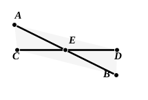

Therefore $CB$ is in a straight line with $BD$.

Therefore etc. Q. E. D.

---

**1. If with any straight line....** There is no greater difficulty in translating the works of the Greek geometers than that of accurately giving the force of prepositions. πρός, for instance, is used in all sorts of expressions with various shades of meaning. The present enunciation begins Ἐὰν πρός τινι εὐθείᾳ καὶ τῷ πρὸς αὐτῇ σημείῳ, and it is really necessary in this one sentence to translate πρός by three different words, *with*, *at*, and *on*. The first πρός must be translated by *with* because two straight lines “make” an angle *with* one another. On the other hand, where the similar expression πρὸς τῇ δοθείσῃ εὐθείᾳ occurs in I. 23, but it is a question of “constructing” an angle (συστήσασθαι), we have to say “to construct *on* a given straight line.” *Against* would perhaps be the English word coming nearest to expressing all these meanings of πρός, but it would be intolerable as a translation.

**17.** Todhunter points out that for the inference in this line Post. 4, that all right angles are equal, is necessary as well as the Common Notion that things which are equal to the same thing (or rather, here, to equal things) are equal. A similar remark applies to steps in the proofs of I. 15 and I. 28.

**24. we can prove.** The Greek expresses this by the future of the verb, δείξομεν, “we shall prove,” which however would perhaps be misleading in English.

Proclus observes (p. 297) that two straight lines on the *same* side of another straight line and meeting it in one and the same point may make with one and the same portion of the straight line terminated at the point two angles which are together equal to two right angles, in which case however the two straight lines would not be in a straight line with one another. And he quotes from Porphyry a construction for two such straight lines in the particular case where they form with the given straight line angles equal respectively to half a right angle and one and a half right angles. There is no particular value in the construction, which will be gathered from the annexed figure where $CE$, $CF$ are drawn at the prescribed inclinations to $CD$.

### PROPOSITION 15.

If two straight lines cut one another, they make the vertical angles equal to one another.

For let the straight lines $AB$, $CD$ cut one another at the point $E$;  
5 I say that the angle $AEC$ is equal to the angle $DEB$,  
and the angle $CEB$ to the angle $AED$.

For, since the straight line $AE$ stands  
10 on the straight line $CD$, making the angles $CEA$, $AED$,  

the angles $CEA$, $AED$ are equal to two right angles. [I. 13]

