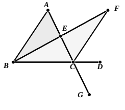

geometrical and arithmetical Books of the *Elements*, and may either result from theorems or problems. Here the Porism is geometrical, and springs out of a theorem; VII. 2 affords an instance of an arithmetical Porism. As an instance of a Porism to a problem Proclus cites “that which is found in the second Book” (τὸ ἐν τῷ δευτέρῳ βιβλίῳ κείμενον); but as to this see notes on II. 4 and IV. 15.

The present Porism, says Proclus, formed the basis of “that paradoxical theorem which proves that only the following three (regular) polygons can fill up the whole space surrounding one point, the equilateral triangle, the square, and the equilateral and equiangular hexagon.” We can in fact place round a point in this manner six equilateral triangles, three regular hexagons, or four squares. “But only the angles of these regular figures, to the number specified, can make up four right angles: a theorem due to the Pythagoreans.”

Proclus further adds that it results from the Porism that, if any number of straight lines intersect one another at one point, the sum of all the angles so formed will still be equal to four right angles. This is of course what is generally given in the text-books as Corollary 2.

### PROPOSITION 16.

In any triangle, if one of the sides be produced, the exterior angle is greater than either of the interior and opposite angles.

Let $ABC$ be a triangle, and let one side of it $BC$ be produced to $D$;  
5 I say that the exterior angle $ACD$ is greater than either of the interior and opposite angles $CBA$, $BAC$.

Let $AC$ be bisected at $E$, [I. 10]  
and let $BE$ be joined and produced  
10 in a straight line to $F$;  
let $EF$ be made equal to $BE$, [I. 3]  
let $FC$ be joined, [Post. 1]  
and let $AC$ be drawn through to $G$. [Post. 2]

Then, since $AE$ is equal to $EC$,  
15 and $BE$ to $EF$,  

the two sides $AE$, $EB$ are equal to the two sides $CE$, $EF$ respectively;

and the angle $AEB$ is equal to the angle $FEC$,  

for they are vertical angles. [I. 15]

20 Therefore the base $AB$ is equal to the base $FC$,

and the triangle $ABE$ is equal to the triangle $CFE$,

and the remaining angles are equal to the remaining angles respectively, namely those which the equal sides subtend; [I. 4]  

therefore the angle $BAE$ is equal to the angle $ECF$.

