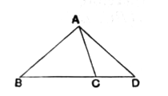
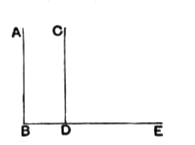

For, if possible, let $AB$, $AC$, $AD$ be all equal, $B$, $C$, $D$ being in a straight line.  
Then, since $AB$, $AC$ are equal, the angles $ABC$, $ACB$ are equal.  
Similarly, since $AB$, $AD$ are equal, the angles $ABD$, $ADB$ are equal.  
Therefore the angle $ACB$ is equal to the angle $ADC$, i.e. the exterior angle to the interior and opposite angle: which is impossible.

Proclus next (p. 308, 14 sqq.) undertakes to prove by means of I. 16 that, *if a straight line falling on two straight lines make the exterior angle equal to the interior and opposite angle, the two straight lines will not form a triangle or meet*, for in that case the same angle would be both greater and equal.

The proof is really equivalent to that of Eucl. I. 27. If $BE$ falls on the two straight lines $AB$, $CD$ in such a way that the angle $CDE$ is equal to the interior and opposite angle $ABD$, $AB$ and $CD$ cannot form a triangle or meet. For, if they did, then (by I. 16) the angle $CDE$ would be greater than the angle $ABD$, while by the hypothesis it is at the same time equal to it.

Hence, says Proclus, in order that $BA$, $DC$ may form a triangle it is necessary for them to *approach* one another in the sense of being turned round one pair of corresponding extremities, e.g. $B$, $D$, so that the other extremities $A$, $C$ come nearer. This may be brought about in one of three ways: (1) $AB$ may remain fixed and $CD$ be turned about $D$ so that the angle $CDE$ increases; (2) $CD$ may remain fixed and $AB$ be turned about $B$ so that the angle $ABD$ becomes smaller; (3) both $AB$ and $CD$ may move so as to make the angle $ABD$ smaller and the angle $CDE$ larger at the same time. The reason, then, of the straight lines $AB$, $CD$ coming to form a triangle or to meet is (says Proclus) *the movement of the straight lines*.

Though he does not mention it here, Proclus does in another passage (p. 371, 2—10, quoted on p. 207 above) hint at the possibility that, while I. 16 may remain universally true, either of the straight lines $BA$, $DC$ (or both together) may be turned through any angle not greater than a certain finite angle and yet may not meet (the Bolyai-Lobachewsky hypothesis).

### PROPOSITION 17.

In any triangle two angles taken together in any manner are less than two right angles.

Let $ABC$ be a triangle;  
I say that two angles of the triangle $ABC$ taken together in any manner are less than two right angles.

For let $BC$ be produced to $D$. [Post. 2]

Then, since the angle $ACD$ is an exterior angle of the triangle $ABC$,  

it is greater than the interior and opposite angle $ABC$.

