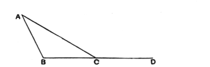
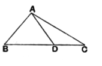

Let the angle $ACB$ be added to each;  
therefore the angles $ACD$, $ACB$ are greater than the angles $ABC$, $BCA$.

But the angles $ACD$, $ACB$ are equal to two right angles. [I. 13]

Therefore the angles $ABC$, $BCA$ are less than two right angles.

Similarly we can prove that the angles $BAC$, $ACB$ are also less than two right angles, and so are the angles $CAB$, $ABC$ as well.

Therefore etc.

Q. E. D.

---

**1. taken together in any manner,** πάντη μεταλαμβανόμεναι, i.e. any pair added together.

As in his note on the previous proposition, Proclus tries to state the *cause* of the property. He takes the case of two straight lines forming right angles with a transversal and observes that it is the *convergence of the straight lines towards one another* (σύνευσις τῶν εὐθειῶν), the lessening of the two right angles, which produces the triangle. He will not have it that the fact of the exterior angle being greater than the interior and opposite angle is the *cause* of the property, for the odd reason that “it is not necessary that a side should be produced, or that there should be any exterior angle constructed...and how can what is not necessary be the cause of what is necessary?” (p. 311, 17—21).

Agreeably to this view, Proclus then sets himself to prove the theorem without producing a side of the triangle.

Let $ABC$ be a triangle. Take any point $D$ on $BC$, and join $AD$.  
Then the exterior angle $ADC$ of the triangle $ABD$ is greater than the interior and opposite angle $ABD$.  
Similarly the exterior angle $ADB$ of the triangle $ADC$ is greater than the interior and opposite angle $ACD$.  
Therefore, by addition, the angles $ADB$, $ADC$ are together greater than the angles $ABC$, $ACB$.  
But the angles $ADB$, $ADC$ are equal to two right angles; therefore the angles $ABC$, $ACB$ are less than two right angles.

Lastly, Proclus proves (what is obvious from this proposition) that *there cannot be more than one perpendicular to a straight line from a point without it*. For, if this were possible, two of such perpendiculars would form a triangle in which two angles would be right angles: which is impossible, since any two angles of a triangle are together less than two right angles.
