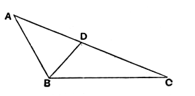
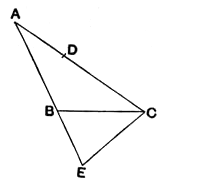

### PROPOSITION 18.

#### *In any triangle the greater side subtends the greater angle.*

For let $ABC$ be a triangle having the side $AC$ greater than $AB$;  
I say that the angle $ABC$ is also greater than the angle $BCA$.

For, since $AC$ is greater than $AB$, let $AD$ be made equal to $AB$ [I. 3], and let $BD$ be joined.

Then, since the angle $ADB$ is an exterior angle of the triangle $BCD$,  
it is greater than the interior and opposite angle $DCB$. [I. 16]

But the angle $ADB$ is equal to the angle $ABD$,  
since the side $AB$ is equal to $AD$;  
therefore the angle $ABD$ is also greater than the angle $ACB$;  
therefore the angle $ABC$ is much greater than the angle $ACB$.

Therefore etc.

Q. E. D.

---

In the enunciation of this proposition we have ὑποτείνειν (“subtend”) used with the simple accusative instead of the more usual ὑπό with accusative. The latter construction is used in the enunciation of I. 19, which otherwise only differs from that of I. 18 in the order of the words. The point to remember in order to distinguish the two is that the *datum* comes first and the *quaesitum* second, the *datum* being in this proposition the *greater side* and in the next the *greater angle*. Thus the enunciations are (I. 18) παντὸς τριγώνου ἡ μείζων πλευρὰ τὴν μείζονα γωνίαν ὑποτείνει and (I. 19) παντὸς τριγώνου ὑπὸ τὴν μείζονα γωνίαν ἡ μείζων πλευρὰ ὑποτείνει. In order to keep the proper order in English we must use the passive of the verb in I. 19. Aristotle quotes the result of I. 19, using the exact wording, ὑπὸ γὰρ τὴν μείζω γωνίαν ὑποτείνει (*Meteorologica* III. 5, 376 a 12).

“In order to assist the student in remembering which of these two propositions [I. 18, 19] is demonstrated directly and which indirectly, it may be observed that the order is similar to that in I. 5 and I. 6” (Todhunter).

An alternative proof of I. 18 given by Porphyry (see Proclus, pp. 315, 11—316, 13) is interesting. It starts by supposing a length equal to $AB$ cut off from the other end of $AC$; that is, $CD$ and not $AD$ is made equal to $AB$.

Produce $AB$ to $E$ so that $BE$ is equal to $AD$, and join $EC$.  
Then, since $AB$ is equal to $CD$, and $BE$ to $AD$,  
$AE$ is equal to $AC$.
