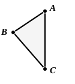

Therefore the angle $AEC$ is equal to the angle $ACE$.  
Now the angle $ABC$ is greater than the angle $AEC$, [I. 16]  
and therefore greater than the angle $ACE$.  
Hence, *a fortiori*, the angle $ABC$ is greater than the angle $ACB$.

### PROPOSITION 19.

In any triangle the greater angle is subtended by the greater side.

Let ">$ABC$ be a triangle having the angle $ABC$ greater than the angle $BCA$;  
I say that the side $AC$ is also greater than the side $AB$.

For, if not, $AC$ is either equal to $AB$ or less.

Now $AC$ is not equal to $AB$;  
for then the angle $ABC$ would also have been equal to the angle $ACB$; [I. 5]  
but it is not;  

therefore $AC$ is not equal to $AB$.

Neither is $AC$ less than $AB$,  
for then the angle $ABC$ would also have been less than the angle $ACB$; [I. 18]  
but it is not;  

therefore $AC$ is not less than $AB$.

And it was proved that it is not equal either.  

Therefore $AC$ is greater than $AB$.

Therefore etc. Q. E. D.

---

This proposition, like I. 6, can be proved by merely *logical* deduction from I. 5 and I. 18 taken together, as pointed out by De Morgan. The general form of the argument used by De Morgan is given in his *Formal Logic* (1847), p. 25, thus:

“*Hypothesis.* Let there be any number of propositions or assertions—three for instance, $X$, $Y$ and $Z$—of which it is the property that one or the other must be true, *and one only*. Let there be three other propositions $P$, $Q$ and $R$ of which it is also the property that one, and one only, must be true. Let it be a connexion of those assertions that:
$$
\begin{aligned}
&\text{when } X \text{ is true, } P \text{ is true,} \\
&\text{when } Y \text{ is true, } Q \text{ is true,} \\
&\text{when } Z \text{ is true, } R \text{ is true.}
\end{aligned}
$$
*Consequence:* then it follows that,
$$
\begin{aligned}
&\text{when } P \text{ is true, } X \text{ is true,} \\
&\text{when } Q \text{ is true, } Y \text{ is true,} \\
&\text{when } R \text{ is true, } Z \text{ is true.”}
\end{aligned}
$$
