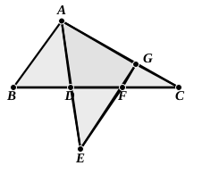

To apply this to the case before us, let us denote the sides of the triangle ">$ABC$ by $a$, $b$, $c$, and the angles opposite to these sides by $A$, $B$, $C$ respectively, and suppose that $a$ is the base.

Then we have the three propositions,
$$
\begin{aligned}
&\text{when } b \text{ is equal to } c\text{, } B \text{ is equal to } C\text{,} & [\textbf{I. } 5] \\
&\left.
\begin{aligned}
&\text{when } b \text{ is greater than } c\text{, } B \text{ is greater than } C\text{,} \\
&\text{when } b \text{ is less than } c\text{, } B \text{ is less than } C\text{,}
\end{aligned}
\right\} & [\textbf{I. } 18]
\end{aligned}
$$
and it follows logically that,
$$
\begin{aligned}
&\text{when } B \text{ is equal to } C\text{, } b \text{ is equal to } c\text{,} & [\textbf{I. } 6] \\
&\left.
\begin{aligned}
&\text{when } B \text{ is greater than } C\text{, } b \text{ is greater than } c\text{,} \\
&\text{when } B \text{ is less than } C\text{, } b \text{ is less than } c\text{.}
\end{aligned}
\right\} & [\textbf{I. } 19]
\end{aligned}
$$

**Reductio ad absurdum by exhaustion.**  
Here, says Proclus (p. 318, 16—23), Euclid proves the impossibility “by means of division” (ἐκ διαιρέσεως). This means simply the separation of different hypotheses, each of which is inconsistent with the truth of the theorem to be proved, and which therefore must be successively shown to be impossible. If a straight line is not greater than a straight line, it must be either equal to it or less; thus in a *reductio ad absurdum* intended to prove such a theorem as I. 19 it is necessary to dispose successively of *two* hypotheses inconsistent with the truth of the theorem.

**Alternative (direct) proof.**  
Proclus gives a direct proof (pp. 319—321) which an-Nairīzī also has and attributes to Heron. It requires a lemma and is consequently open to the slight objection of separating a theorem from its converse. But the lemma and proof are worth giving.

*Lemma.*

*If an angle of a triangle be bisected and the straight line bisecting it meet the base and divide it into unequal parts, the sides containing the angle will be unequal, and the greater will be that which meets the greater segment of the base, and the less that which meets the less.*

Let $AD$, the bisector of the angle $A$ of the triangle ">$ABC$, meet $BC$ in $D$, making $CD$ greater than $BD$.  
I say that $AC$ is greater than $AB$.

Produce $AD$ to $E$ so that $DE$ is equal to $AD$. And, since $DC$ is greater than $BD$, cut off $DF$ equal to $BD$.  
Join $EF$ and produce it to $G$.  
Then, since the two sides $AD$, $DB$ are equal to the two sides $ED$, $DF$, and the vertical angles at $D$ are equal,  
$AB$ is equal to $EF$,  
and the angle $DEF$ to the angle $BAD$,  
i.e. to the angle $DAG$ (by hypothesis).  
Therefore $AG$ is equal to $EG$,  
and therefore greater than $EF$, or $AB$.  
Hence, *a fortiori*, $AC$ is greater than $AB$.
