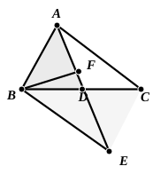
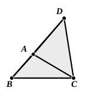

**Proof of I. 19.**

Let $ABC$ be a triangle in which the angle $ABC$ is greater than the angle $ACB$.  
Bisect $BC$ at $D$, join $AD$, and produce it to $E$ so that $DE$ is equal to $AD$. Join $BE$.

Then the two sides $BD$, $DE$ are equal to the two sides $CD$, $DA$, and the vertical angles at $D$ are equal;  
therefore $BE$ is equal to $AC$,  
and the angle $DBE$ to the angle at $C$.  
But the angle at $C$ is less than the angle $ABC$;  
therefore the angle $DBE$ is less than the angle $ABD$.  
Hence, if $BF$ bisect the angle $ABE$, $BF$ meets $AE$ between $A$ and $D$. Therefore $EF$ is greater than $FA$.  
It follows, by the lemma, that $BE$ is greater than $BA$,  
that is, $AC$ is greater than $AB$.

### PROPOSITION 20.

In any triangle two sides taken together in any manner are greater than the remaining one.

For let $ABC$ be a triangle;  
I say that in the triangle $ABC$ two sides taken together in any manner are greater than the remaining one, namely  

$BA$, $AC$ greater than $BC$,

$AB$, $BC$ greater than $AC$,

$BC$, $CA$ greater than $AB$.

For let $BA$ be drawn through to the point $D$, let $DA$ be made equal to $CA$, and let $DC$ be joined.

Then, since $DA$ is equal to $AC$,  
the angle $ADC$ is also equal to the angle $ACD$; [I. 5]  

therefore the angle $BCD$ is greater than the angle $ADC$. [C. N. 5]

And, since $DCB$ is a triangle having the angle $BCD$ greater than the angle $BDC$,  
and the greater angle is subtended by the greater side, [I. 19]  

therefore $DB$ is greater than $BC$.

