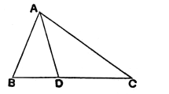
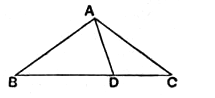

But $DA$ is equal to $AC$;  
therefore $BA$, $AC$ are greater than $BC$.

Similarly we can prove that $AB$, $BC$ are also greater than $CA$, and $BC$, $CA$ than $AB$.

Therefore etc.

Q. E. D.

---

It was the habit of the Epicureans, says Proclus (p. 322), to ridicule this theorem as being evident even to an ass and requiring no proof, and their allegation that the theorem was “known” (γνώριμον) even to an ass was based on the fact that, if fodder is placed at one angular point and the ass at another, he does not, in order to get to his food, traverse the two sides of the triangle but only the one side separating them (an argument which makes Savile exclaim that its authors were “*digni ipsi, qui cum Asino foenum essent*,” p. 78). Proclus replies truly that a mere perception of the truth of the theorem is a different thing from a scientific proof of it and a knowledge of the reason *why* it is true. Moreover, as Simson says, the number of axioms should not be increased without necessity.

**Alternative Proofs.**

Heron and Porphyry, we are told (Proclus, pp. 323–6), proved this theorem in *different* ways as follows, without producing one of the sides.

*First proof.*

Let $ABC$ be the triangle, and let it be required to prove that the sides $BA$, $AC$ are greater than $BC$.

Bisect the angle $BAC$ by $AD$ meeting $BC$ in $D$.

Then, in the triangle $ABD$, the exterior angle $ADC$ is greater than the interior and opposite angle $BAD$, [I. 16]  
that is, greater than the angle $DAC$.

Therefore the side $AC$ is greater than the side $CD$. [I. 19]

Similarly we can prove that $AB$ is greater than $BD$.

Hence, by addition, $BA$, $AC$ are greater than $BC$.

*Second proof.*

This, like the first proof, is direct. There are several cases to be considered.

(1) If the triangle is *equilateral*, the truth of the proposition is obvious.

(2) If the triangle is *isosceles*, the proposition needs no proof in the case (*a*) where each of the equal sides is greater than the base.

(*b*) If the base is greater than either of the other sides, we have to prove that the sum of the two equal sides is greater than the base. Let $BC$ be the base in such a triangle.

Cut off from $BC$ a length $BD$ equal to $AB$, and join $AD$.

Then, in the triangle $ADB$, the exterior angle $ADC$ is greater than the interior and opposite angle $BAD$. [I. 16]

Similarly, in the triangle $ADC$, the exterior angle $ADB$ is greater than the interior and opposite angle $CAD$.
