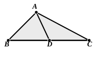
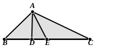

By addition, the two angles $BDA$, $ADC$ are together greater than the two angles $BAD$, $DAC$ (or the whole angle $BAC$).

Subtracting the equal angles $BDA$, $BAD$, we have the angle $ADC$ greater than the angle $CAD$.

It follows that $AC$ is greater than $CD$; [I. 19]  
and, adding the equals $AB$, $BD$ respectively, we have $BA$, $AC$ together greater than $BC$.

(3) If the triangle be *scalene*, we can arrange the sides in order of length. Suppose $BC$ is the greatest, $AB$ the intermediate and $AC$ the least side. Then it is obvious that $AB$, $BC$ are together greater than $AC$, and $BC$, $CA$ together greater than $AB$.

It only remains therefore to prove that $CA$, $AB$ are together greater than $BC$.

We cut off from $BC$ a length $BD$ equal to the adjacent side, join $AD$, and proceed exactly as in the above case of the isosceles triangle.

*Third proof.*

This proof is by *reductio ad absurdum*.

Suppose that $BC$ is the greatest side and, as before, we have to prove that $BA$, $AC$ are greater than $BC$.

If they are not, they must be either equal to or less than $BC$.

(1) Suppose $BA$, $AC$ are together equal to $BC$.

From $BC$ cut off $BD$ equal to $BA$, and join $AD$.

It follows from the hypothesis that $DC$ is equal to $AC$.

Then, since $BA$ is equal to $BD$,  
the angle $BDA$ is equal to the angle $BAD$.

Similarly, since $AC$ is equal to $CD$,  
the angle $CDA$ is equal to the angle $CAD$.

By addition, the angles $BDA$, $ADC$ are together equal to the whole angle $BAC$.

That is, the angle $BAC$ is equal to two right angles: which is impossible.

(2) Suppose $BA$, $AC$ are together less than $BC$.

From $BC$ cut off $BD$ equal to $BA$, and from $CB$ cut off $CE$ equal to $CA$. Join $AD$, $AE$.

In this case, we prove in the same way that  
the angle $BDA$ is equal to the angle $BAD$, and  
the angle $CEA$ to the angle $CAE$.

By addition, the sum of the angles $BDA$, $AEC$ is equal to the sum of the angles $BAD$, $CAE$.

Now, by I. 16, the angle $BDA$ is greater than the angle $DAC$, and therefore, *a fortiori*, greater than the angle $EAC$.

Similarly the angle $AEC$ is greater than the angle $BAD$.

Hence the sum of the angles $BDA$, $AEC$ is greater than the sum of the angles $BAD$, $EAC$.

But the former sum was also equal to the latter: which is impossible.
