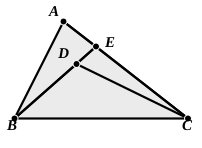

### PROPOSITION 21.

If on one of the sides of a triangle, from its extremities, there be constructed two straight lines meeting within the triangle, the straight lines so constructed will be less than the remaining two sides of the triangle, but will contain a greater 5 angle.

On $BC$, one of the sides of the triangle ">$ABC$, from its extremities $B$, $C$, let the two straight lines $BD$, $DC$ be constructed meeting within the triangle;  
I say that $BD$, $DC$ are less than the remaining two sides 10 of the triangle $BA$, $AC$, but contain an angle $BDC$ greater than the angle $BAC$.

For let $BD$ be drawn through to $E$.  
Then, since in any triangle two sides are greater than the remaining 15 one, [I. 20]  

therefore, in the triangle ">$ABE$, the two sides $AB$, $AE$ are greater than $BE$.

Let $EC$ be added to each;

therefore $BA$, $AC$ are greater than $BE$, $EC$.

20 Again, since, in the triangle ">$CED$,  

the two sides $CE$, $ED$ are greater than $CD$,

let $DB$ be added to each;

therefore $CE$, $EB$ are greater than $CD$, $DB$.

But $BA$, $AC$ were proved greater than $BE$, $EC$;  

25 therefore $BA$, $AC$ are much greater than $BD$, $DC$.

Again, since in any triangle the exterior angle is greater than the interior and opposite angle, [I. 16]  
therefore, in the triangle ">$CDE$,  

the exterior angle $BDC$ is greater than the angle $CED$.

30 For the same reason, moreover, in the triangle ">$ABE$ also,  

the exterior angle $CEB$ is greater than the angle $BAC$.

But the angle $BDC$ was proved greater than the angle $CEB$;  

therefore the angle $BDC$ is much greater than the angle $BAC$.

35 Therefore etc. Q. E. D.

---

**2. be constructed...meeting within the triangle.** The word “meeting” is not in the Greek, where the words are ἐντὸς συσταθῶσιν. συνίστασθαι is the word used of constructing two straight lines to a point (cf. I. 7) or so as to form a triangle; but it is necessary in English to indicate that they meet.

**3. the straight lines so constructed.** Observe the elegant brevity of the Greek αἱ συσταθεῖσαι.
