The editors generally call attention to the fact that the lines drawn within the triangle in this proposition must be drawn, as the enunciation says, from the *ends* of the side; otherwise it is not necessary that their sum should be less than that of the remaining sides of the triangle. Proclus (p. 327, 12 sqq.) gives a simple illustration.

Let $ABC$ be a right-angled triangle. Take any point $D$ on $BC$, join $DA$, and cut off from it $DE$ equal to $AB$. Bisect $AE$ at $F$, and join $FC$.  
Then shall $CF$, $FD$ be together greater than $CA$, $AB$.  
For $CF$, $FE$ are equal to $CF$, $FA$,  
and therefore greater than $CA$.  
Add the equals $ED$, $AB$ respectively;  
therefore $CF$, $FD$ are together greater than $CA$, $AB$.

Pappus gives the same proposition as that just proved, but follows it up by a number of others more elaborate in character, selected apparently from “the so-called paradoxes” of one Erycinus (Pappus, III. p. 106 sqq.). Thus he proves the following:

1. In any triangle, except an equilateral triangle or an isosceles triangle with base less than one of the other sides, it is possible to construct on the base and within the triangle two straight lines the sum of which is equal to the sum of the other two sides of the triangle.
2. In any triangle in which it is possible to construct two straight lines on the base which are equal to the sum of the other two sides of the triangle it is also possible to construct two others the sum of which is *greater* than that sum.
3. Under the same conditions, if the base is greater than either of the other two sides, two straight lines can be constructed in the manner described which are respectively *greater* than the other two sides of the triangle; and the lines may be constructed so as to be respectively *equal* to the two sides, if one of those two sides is less than the other and each of them less than the base.
4. The lines may be so constructed that their sum will bear to the sum of the two sides of the triangle any ratio less than 2 : 1.

As a specimen of the proofs we will give that of the proposition which has been numbered (1) for the case where the triangle is isosceles (Pappus, III. pp. 108—110).

