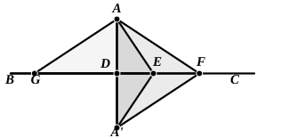

Let ">$ABC$ be an isosceles triangle in which the base $AC$ is greater than either of the equal sides $AB$, $BC$.  
With centre $A$ and radius $AB$ describe a circle meeting $AC$ in $D$.  
Draw any radius $AEF$ such that it meets $BC$ in a point $F$ outside the circle.  
Take any point $G$ on $EF$, and through it draw $GH$ parallel to $AC$. Take any point $K$ on $GH$, and draw $KL$ parallel to $FA$ meeting $AC$ in $L$.  
From $BC$ cut off $BN$ equal to $EG$.  
Thus $AG$, or $LK$, is equal to the sum of $AB$, $BN$, and $CN$ is less than $LK$.  
Now $GF$, $FH$ are together greater than $GH$,  
and $CH$, $HK$ together greater than $CK$.  
Therefore, by addition,  
$CF$, $FG$, $HK$ are together greater than $CK$, $HG$.  
Subtracting $HK$ from each side, we see that  
$CF$, $FG$ are together greater than $CK$, $KG$;  
therefore, if we add $AG$ to each,  
$AF$, $FC$ are together greater than $AG$, $GK$, $KC$.  
And $AB$, $BC$ are together greater than $AF$, $FC$. [I. 21]  
Therefore $AB$, $BC$ are together greater than $AG$, $GK$, $KC$.  
But, by construction, $AB$, $BN$ are together equal to $AG$;  
therefore, by subtraction, $NC$ is greater than $GK$, $KC$,  
and *a fortiori* greater than $KC$.  
Take on $KC$ produced a point $M$ such that $KM$ is equal to $NC$;  
with centre $K$ and radius $KM$ describe a circle meeting $CL$ in $O$, and join $KO$.  
Then shall $LK$, $KO$ be equal to $AB$, $BC$.  
For, by construction, $LK$ is equal to the sum of $AB$, $BN$, and $KO$ is equal to $NC$;  
therefore $LK$, $KO$ are together equal to $AB$, $BC$.

It is after I. 21 that (as remarked by De Morgan) the important proposition about the perpendicular and obliques drawn from a point to a straight line of unlimited length is best introduced:

*Of all straight lines that can be drawn to a given straight line of unlimited length from a given point without it:*  
*(a) the perpendicular is the shortest;*  
*(b) of the obliques, that is the greater the foot of which is further from the perpendicular;*  
*(c) given one oblique, only one other can be found of the same length, namely that the foot of which is equally distant with the foot of the given one from the perpendicular, but on the other side of it.*

Let $A$ be the given point, $BC$ the given straight line; let $AD$ be the perpendicular from $A$ on $BC$, and $AE$, $AF$ any two obliques of which $AF$ makes the greater angle with $AD$.

Produce $AD$ to $A'$, making $A'D$ equal to $AD$, and join $A'E$, $A'F$.  
Then the triangles ">$ADE$, ">$A'DE$ are equal in all respects; and so are the triangles ">$ADF$, ">$A'DF$.

Now (1) in the triangle ">$AEA'$ the two sides $AE$, $EA'$ are greater than $AA'$ [I. 20], that is, twice $AE$ is greater than twice $AD$.
