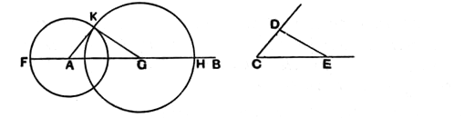

straight lines $CD$, $DE$, $CE$ let the triangle $AFG$ be constructed in such a way that $CD$ is equal to $AF$, $CE$ to $AG$, and further $DE$ to $FG$. [I. 22]

Then, since the two sides $DC$, $CE$ are equal to the two sides $FA$, $AG$ respectively,  
and the base $DE$ is equal to the base $FG$,  
the angle $DCE$ is equal to the angle $FAG$. [I. 8]

Therefore on the given straight line $AB$, and at the point $A$ on it, the rectilineal angle $FAG$ has been constructed equal to the given rectilineal angle $DCE$.

Q. E. F.

This problem was, according to Eudemus (see Proclus, p. 333, 5), “rather the discovery of Oenopides,” from which we must apparently infer, not that Oenopides was the first to find any solution of it, but that it was he who discovered the particular solution given by Euclid. (Cf. Bretschneider, p. 65.)

The editors do not seem to have noticed the fact that the construction of the triangle assumed in this proposition is not exactly the construction given in **I.** 22. We have here to construct a triangle on a certain finite straight line $AG$ as base; in **I.** 22 we have only to construct a triangle with sides of given length without any restriction as to how it is to be placed. Thus in **I.** 22 we set out any line whatever and measure successively three lengths along it beginning from the given extremity, and what we must regard as the base is the intermediate length, not the length beginning at the given extremity, of the straight line arbitrarily set out. Here the base is a given straight line abutting at a given point. Thus the construction has to be modified somewhat from that of the preceding proposition.

We must measure $AG$ along $AB$ so that $AG$ is equal to $CE$ (or $CD$), and $GH$ along $GB$ equal to $DE$; and then we must produce $BA$, in the opposite direction, to $F$, so that $AF$ is equal to $CD$ (or $CE$, if $AG$ has been made equal to $CD$).

Then, by drawing circles (1) with centre $A$ and radius $AF$, (2) with centre $G$ and radius $GH$, we determine $K$, one of their points of intersection, and we prove that the triangle $KAG$ is equal in all respects to the triangle $DCE$, and then that the angle at $A$ is equal to the angle $DCE$.

I think that Proclus must (though he does not say so) have felt the same difficulty with regard to the use in **I.** 23 of the result of **I.** 22, and that this is probably the reason why he gives over again the construction which I have given above, with the remark (p. 334, 6) that “you may obtain the construction of the triangle in a more instructive manner (διδασκαλικώτερον) as follows.”

Proclus objects to the procedure of Apollonius in constructing an angle under the same conditions, and certainly, if he quotes Apollonius correctly, the latter’s exposition must have been somewhat slipshod.
