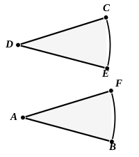
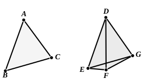

“He takes an angle $CDE$ at random,” says Proclus (p. 335, 19 sqq.), “and a straight line $AB$, and with centre $D$ and distance $CD$ describes the circumference $CE$, and in the same way with centre $A$ and distance $AB$ the circumference $FB$. Then, cutting off $FB$ equal to $CE$, he joins $AF$. And he declares that the angles $A$, $D$ standing on equal circumferences are equal.”

In the first place, as Proclus remarks, it should be premised that $AB$ is equal to $CD$ in order that the circles may be equal; and the use of Book **III.** for such an elementary construction is objectionable. The omission to state that $AB$ must be taken equal to $CD$ was no doubt a slip, if it occurred. And, as regards the equal angles “standing on equal circumferences,” it would seem possible that Apollonius said this *in explanation*, for the sake of brevity, rather than by way of proof. It seems to me probable that his construction was only given from the point of view of *practical*, not theoretical, geometry. It really comes to the same thing as Euclid’s except that $DC$ is taken equal to $DE$. For cutting off the arc $BF$ equal to the arc $CE$ can only be meant in the sense of measuring the chord $CE$, say, with a pair of compasses, and then drawing a circle with centre $B$ and radius equal to the chord $CE$. Apollonius’ direction was therefore probably intended as a practical short cut, avoiding the actual drawing of the chords $CE$, $BF$, which, as well as a proof of the equality in all respects of the triangles ">$CDE$, ">$BAF$, would be required to establish *theoretically* the correctness of the construction.

### PROPOSITION 24.

If two triangles have the two sides equal to two sides respectively, but have the one of the angles contained by the equal straight lines greater than the other, they will also have the base greater than the base.

5 Let ">$ABC$, ">$DEF$ be two triangles having the two sides $AB$, $AC$ equal to the two sides $DE$, $DF$ respectively, namely $AB$ to $DE$, and $AC$ to $DF$, and let the angle at $A$ be greater than the angle at $D$;  
I say that the base $BC$ is also greater than the base $EF$.

10 For, since the angle $BAC$ is greater than the angle $EDF$,  
let there be constructed, on the straight line $DE$, and at the point $D$ on it, the angle $EDG$  
15 equal to the angle $BAC$; [I. 23]  
let $DG$ be made equal to either of the two straight lines $AC$, $DF$,  
and let $EG$, $FG$ be joined.
