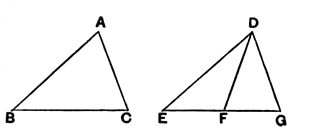
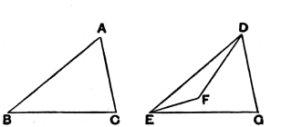

Then, since $AB$ is equal to $DE$, and $AC$ to $DG$,  
20 the two sides $BA$, $AC$ are equal to the two sides $ED$, $DG$, respectively;  
and the angle $BAC$ is equal to the angle $EDG$;  

therefore the base $BC$ is equal to the base $EG$. [I. 4]

Again, since $DF$ is equal to $DG$,  

25 the angle $DGF$ is also equal to the angle $DFG$; [I. 5]

therefore the angle $DFG$ is greater than the angle $EGF$.

Therefore the angle $EFG$ is much greater than the angle $EGF$.

And, since $EFG$ is a triangle having the angle $EFG$ greater than the angle $EGF$,  

30 and the greater angle is subtended by the greater side, [I. 19]

the side $EG$ is also greater than $EF$.

But $EG$ is equal to $BC$.  

Therefore $BC$ is also greater than $EF$.

35 Therefore etc. Q. E. D.

---

**10.** I have naturally left out the well-known words added by Simson in order to avoid the necessity of considering three cases: “Of the two sides $DE$, $DF$ let $DE$ be the side which is not greater than the other.” I doubt whether Euclid could have been induced to insert the words himself, even if it had been represented to him that their omission meant leaving two possible cases out of consideration. His habit and that of the great Greek geometers was, not to set out all possible cases, but to give as a rule one case, generally the most difficult, as here, and to leave the others to the reader to work out for himself. We have already seen one instance in I. 7.

Proclus of course gives the other two cases which arise if we do not first provide that $DE$ is not greater than $DF$.

(1) In the first case $G$ may fall on $EF$ produced, and it is then obvious that $EG$ is greater than $EF$.

(2) In the second case $EG$ may fall below $EF$.

If so, by I. 21, $DF$, $FE$ are together less than $DG$, $GE$.  
But $DF$ is equal to $DG$; therefore $EF$ is less than $EG$, i.e. than $BC$.

These two cases are therefore decidedly simpler than the case taken by Euclid as typical, and could well be left to the ingenuity of the learner.

If however after all we prefer to insert Simson's words and avoid the latter
