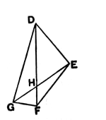
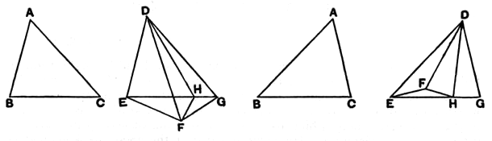

two cases, the proof is not complete unless we show that, with his assumption, $F$ must, in the figure of the proposition, fall below $EG$.

De Morgan would make the following proposition precede: *Every straight line drawn from the vertex of a triangle to the base is less than the greater of the two sides, or than either if they are equal*, and he would prove it by means of the proposition relating to perpendicular and obliques given above, p. 291.

But it is easy to prove directly that $F$ falls below $EG$, if $DE$ is not greater than $DG$, by the method employed by Pfleiderer, Lardner, and Todhunter.

Let $DF$, produced if necessary, meet $EG$ in $H$.  
Then the angle $DHG$ is greater than the angle $DEG$; [I. 16]  
and the angle $DEG$ is not less than the angle $DGE$; [I. 18]  
therefore the angle $DHG$ is greater than the angle $DGH$.  
Hence $DH$ is less than $DG$, [I. 19]  
and therefore $DH$ is less than $DF$.

**Alternative proof.**

Lastly, the modern alternative proof is worth giving.

Let $DH$ bisect the angle $FDG$ (after the triangle $DEG$ has been made equal in all respects to the triangle $ABC$, as in the proposition), and let $DH$ meet $EG$ in $H$. Join $HF$.

Then, in the triangles $FDH$, $GDH$,  
the two sides $FD$, $DH$ are equal to the two sides $GD$, $DH$,  
and the included angles $FDH$, $GDH$ are equal;  
therefore the base $HF$ is equal to the base $HG$.  
Accordingly $EG$ is equal to the sum of $EH$, $HF$;  
and $EH$, $HF$ are together greater than $EF$; [I. 20]  
therefore $EG$, or $BC$, is greater than $EF$.

Proclus (p. 339, 11 sqq.) answers by anticipation the possible question that might occur to any one on this proposition, viz. why does Euclid not compare the areas of the triangles as he does in I. 4? He observes that inequality of the areas does not follow from the inequality of the angles contained by the equal sides, and that Euclid leaves out all reference to the question both for this reason and because the areas cannot be compared without the help of the theory of parallels. “But if,” says Proclus, “we must anticipate what is to come and make our comparison of the areas at once, we assert that (1) *if the angles $A$, $D$—supposing that our argument proceeds with reference to the figure in the proposition—are* (together) *equal to two right angles, the triangles*
