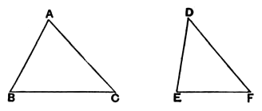

*are proved equal, (2) if greater than two right angles, that triangle which has the greater angle is less, and (3) if they are less, greater.”* Proclus then gives the proof, but without any reference to the source from which he quoted the proposition. Now an-Nairīzī adds a similar proposition to I. 38, but definitely attributes it to Heron. I shall accordingly give it in the place where Heron put it

### PROPOSITION 25.

If two triangles have the two sides equal to two sides respectively, but have the base greater than the base, they will also have the one of the angles contained by the equal straight lines greater than the other.

Let $ABC$, $DEF$ be two triangles having the two sides $AB$, $AC$ equal to the two sides $DE$, $DF$ respectively, namely $AB$ to $DE$, and $AC$ to $DF$; and let the base $BC$ be greater than the base $EF$;  
I say that the angle $BAC$ is also greater than the angle $EDF$.

For, if not, it is either equal to it or less.

Now the angle $BAC$ is not equal to the angle $EDF$;  

for then the base $BC$ would also have been equal to the base $EF$, [I. 4]

but it is not;

therefore the angle $BAC$ is not equal to the angle $EDF$.

Neither again is the angle $BAC$ less than the angle $EDF$;  

for then the base $BC$ would also have been less than the base $EF$, [I. 24]

but it is not;

therefore the angle $BAC$ is not less than the angle $EDF$.

But it was proved that it is not equal either;  

therefore the angle $BAC$ is greater than the angle $EDF$.

Therefore etc. Q. E. D.

