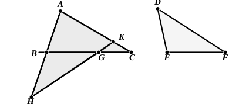

De Morgan points out that this proposition (as also I. 8) is a purely *logical* consequence of I. 4 and I. 24 in the same way as I. 19 and I. 6 are purely *logical* consequences of I. 18 and I. 5. If $a, b, c$ denote the sides, $A, B, C$ the angles opposite to them in a triangle $ABC$, and $a', b', c', A', B', C'$ the sides and opposite angles respectively in a triangle $A'B'C'$, I. 4 and I. 24 tell us that, $b, c$ being respectively equal to $b', c'$,
$$
\begin{aligned}
&\text{(1) if } A \text{ is equal to } A'\text{, then } a \text{ is equal to } a'\text{,} \\
&\text{(2) if } A \text{ is less than } A'\text{, then } a \text{ is less than } a'\text{,} \\
&\text{(3) if } A \text{ is greater than } A'\text{, then } a \text{ is greater than } a'\text{;}
\end{aligned}
$$
and it follows logically that,
$$
\begin{aligned}
&\text{(1) if } a \text{ is equal to } a'\text{, the angle } A \text{ is equal to the angle } A'\text{,} & [\textbf{I. 8}] \\
&\left.
\begin{aligned}
&\text{(2) if } a \text{ is less than } a'\text{, } A \text{ is less than } A'\text{,} \\
&\text{(3) if } a \text{ is greater than } a'\text{, } A \text{ is greater than } A'\text{.}
\end{aligned}
\right\} & [\textbf{I. 25}]
\end{aligned}
$$

Two alternative proofs of this theorem are given by Proclus (pp. 345–7), and they are both interesting. Moreover both are *direct*.

**I. Proof by Menelaus of Alexandria.**

Let $ABC$, $DEF$ be two triangles having the two sides $BA$, $AC$ equal to the two sides $ED$, $DF$, but the base $BC$ greater than the base $EF$.

Then shall the angle at $A$ be greater than the angle at $D$.

From $BC$ cut off $BG$ equal to $EF$. At $B$, on the straight line $BC$, make the angle $GBH$ (on the side of $BG$ remote from $A$) equal to the angle $FED$.  
Make $BH$ equal to $DE$; join $HG$, and produce it to meet $AC$ in $K$.  
Join $AH$.

Then, since the two sides $GB$, $BH$ are equal to the two sides $FE$, $ED$ respectively,  
and the angles contained by them are equal,  
$HG$ is equal to $DF$ or $AC$,  
and the angle $BHG$ is equal to the angle $EDF$.  
Now $HK$ is greater than $HG$ or $AC$,  
and *a fortiori* greater than $AK$;  
therefore the angle $KAH$ is greater than the angle $KHA$.  
And, since $AB$ is equal to $BH$,  
the angle $BAH$ is equal to the angle $BHA$.  
Therefore, by addition,  
the whole angle $BAC$ is greater than the whole angle $BHG$,  
that is, greater than the angle $EDF$.
