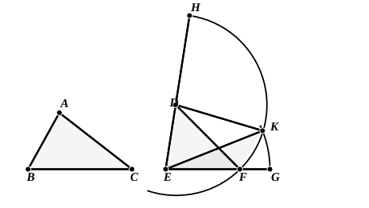

**II. Heron's proof.**

Let the triangles be given as before.  
Since $BC$ is greater than $EF$, produce $EF$ to $G$ so that $EG$ is equal to $BC$.  
Produce $ED$ to $H$ so that $DH$ is equal to $DF$. The circle with centre $D$ and radius $DF$ will then pass through $H$. Let it be described, as $FKH$.

Now, since $BA$, $AC$ are together greater than $BC$,  
and $BA$, $AC$ are equal to $ED$, $DH$ respectively,  
while $BC$ is equal to $EG$,  
$EH$ is greater than $EG$.  
Therefore the circle with centre $E$ and radius $EG$ will cut $EH$, and therefore will cut the circle already drawn. Let it cut that circle in $K$, and join $DK$, $KE$.  
Then, since $D$ is the centre of the circle $FKH$,  
$DK$ is equal to $DF$ or $AC$.  
Similarly, since $E$ is the centre of the circle $KG$,  
$EK$ is equal to $EG$ or $BC$,  
And $DE$ is equal to $AB$.  
Therefore the two sides $BA$, $AC$ are equal to the two sides $ED$, $DK$ respectively;  
and the base $BC$ is equal to the base $EK$;  
therefore the angle $BAC$ is equal to the angle $EDK$.  
Therefore the angle $BAC$ is greater than the angle $EDF$.

### PROPOSITION 26.

#### *If two triangles have the two angles equal to two angles respectively, and one side equal to one side, namely, either the side adjoining the equal angles, or that subtending one of the equal angles, they will also have the remaining sides equal to 5the remaining sides and the remaining angle to the remaining angle.*
