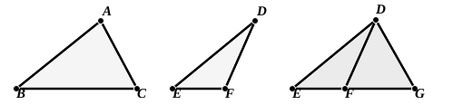

side and one angle in each triangle is not enough, the equality ($a$) of one side and all three angles is more than enough, as is also the equality ($b$) of two sides and two or three angles, and ($c$) of three sides and one or two angles.

The only hypotheses therefore to be examined from this point of view are the equality of  
(a) three sides [Eucl. I. 8].  
(β) two sides and one angle [I. 4 proves one case of this, where the angle is that contained by the sides which are by hypothesis equal].  
(γ) one side and two angles [I. 26 covers all cases].

It is curious that Proclus makes no allusion to what we call the *ambiguous case*, that case namely of (β) in which it is an angle opposite to one of the two specified sides in one triangle which is equal to the angle opposite to the equal side in the other triangle. Camerer indeed attributes to Proclus the observation that in this case the equality of the triangles cannot, unless some other condition is added, be asserted generally; but it would appear that Camerer was probably misled by a figure (Proclus, p. 351) which looks like a figure of the ambiguous case but is really only used to show that in I. 26 the equal sides must be *corresponding* sides, i.e., they must be either adjacent to the equal angles in each triangle, or opposite to corresponding equal angles, and that, e.g., one of the equal sides must not be adjacent to the two angles in one triangle, while the side equal to it in the other triangle is opposite to one of the two corresponding angles in that triangle.

### The ambiguous case.

*If two triangles have two sides equal to two sides respectively, and if the angles opposite to one pair of equal sides be also equal, then will the angles opposite the other pair of equal sides be either equal or supplementary ; and, in the former case, the triangles will be equal in all respects.*

Let ">$ABC$, ">$DEF$ be two triangles such that $AB$ is equal to $DE$, and $AC$ to $DF$, while the angle $ABC$ is equal to the angle $DEF$;  
it is required to prove that the angles $ACB$, $DFE$ are either equal or supplementary.

Now (1), if the angle $BAC$ be equal to the angle $EDF$, it follows, since the two sides $AB$, $AC$ are equal to the two sides $DE$, $DF$ respectively, that  
the triangles ">$ABC$, ">$DEF$ are equal in all respects, [I. 4]  
and the angles $ACB$, $DFE$ are equal.

(2) If the angles $BAC$, $EDF$ be not equal, make the angle $EDG$ (on the same side of $ED$ as the angle $EDF$) equal to the angle $BAC$.  
Let $EF$, produced if necessary, meet $DG$ in $G$.  
Then, in the triangles ">$ABC$, ">$DEG$,  
the two angles $BAC$, $ABC$ are equal to the two angles $EDG$, $DEG$ respectively,  
and the side $AB$ is equal to the side $DE$;
