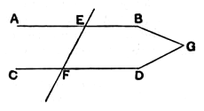

therefore the triangles $ABC$, $DEG$ are equal in all respects, [**I.** 26]  
    so that the side $AC$ is equal to the side $DG$,  
    and the angle $ACB$ is equal to the angle $DGE$.  
Again, since $AC$ is equal to $DF$ as well as to $DG$,  
    $DF$ is equal to $DG$,  
and therefore the angles $DFG$, $DGF$ are equal.  
    But the angle $DFE$ is supplementary to the angle $DFG$; and the angle $DGF$ was proved equal to the angle $ACB$;  
    therefore the angle $DFE$ is supplementary to the angle $ACB$.

If it is desired to avoid the ambiguity and secure that the triangles may be congruent, we can introduce the necessary conditions into the enunciation, on the analogy of Eucl. **VI.** 7.

*If two triangles have two sides of the one equal to two sides of the other respectively, and the angles opposite to a pair of equal sides equal, then, if the angles opposite to the other pair of equal sides are both acute, or both obtuse, or if one of them is a right angle, the two triangles are equal in all respects.*

The proof of the three cases (by *reductio ad absurdum*) was given by Todhunter.

### PROPOSITION 27.

If a straight line falling on two straight lines make the alternate angles equal to one another, the straight lines will be parallel to one another.

For let the straight line $EF$ falling on the two straight  
5lines $AB$, $CD$ make the alternate angles $AEF$, $EFD$ equal to one another;  
I say that $AB$ is parallel to $CD$.

For, if not, $AB$, $CD$ when produced will meet either in the direction  
10of $B$, $D$ or towards $A$, $C$.  
Let them be produced and meet, in the direction of $B$, $D$, at $G$.

Then, in the triangle $GEF$, the exterior angle $AEF$ is equal to the interior and opposite  
15angle $EFG$:  

which is impossible. [I. 16]

Therefore $AB$, $CD$ when produced will not meet in the direction of $B$, $D$.

Similarly it can be proved that neither will they meet  
20towards $A$, $C$.

