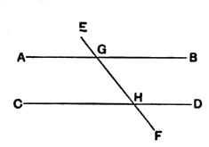
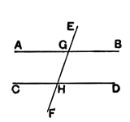

For let the straight line $EF$ falling on the two straight lines $AB$, $CD$ make the exterior angle $EGB$ equal to the interior and opposite angle $GHD$, or the interior angles on the same side, namely $BGH$, $GHD$, equal to two right angles;  
I say that $AB$ is parallel to $CD$.

For, since the angle $EGB$ is equal to the angle $GHD$,  
while the angle $EGB$ is equal to the angle $AGH$, [I. 15]  

the angle $AGH$ is also equal to the angle $GHD$;

and they are alternate;

therefore $AB$ is parallel to $CD$. [I. 27]

Again, since the angles $BGH$, $GHD$ are equal to two right angles,  
and the angles $AGH$, $BGH$ are also equal to two right angles, [I. 13]  

the angles $AGH$, $BGH$ are equal to the angles $BGH$, $GHD$.

Let the angle $BGH$ be subtracted from each;  

therefore the remaining angle $AGH$ is equal to the remaining angle $GHD$;

and they are alternate;

therefore $AB$ is parallel to $CD$. [I. 27]

Therefore etc. Q. E. D.

---

One criterion of parallelism, the equality of alternate angles, is given in **I.** 27; here we have two more, each of which is easily reducible, and is actually reduced, to the other.

Proclus observes (pp. 358—9) that Euclid could have stated six criteria as well as three, by using, in addition, other pairs of angles in the figure (not adjacent) of which it could be predicated that the two angles are equal or that their sum is equal to two right angles. A natural division is to consider, first the pairs which are on the *same* side of the transversal, and secondly the pairs which are on *different* sides of it.

Taking (1) the possible pairs on the *same* side, we may have a pair consisting of

*(a)* two internal angles, viz. the pairs ($BGH$, $GHD$) and ($AGH$, $GHC$);

*(b)* two external angles, viz. the pairs ($EGB$, $DHF$) and ($EGA$, $CHF$);

*(c)* one external and one internal angle, viz. the pairs ($EGB$, $GHD$), ($FHD$, $HGB$), ($EGA$, $GHC$) and ($FHC$, $HGA$).
