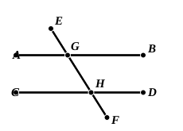

And (2) the possible pairs on *different* sides of the transversal may consist respectively of  
($a$) two internal angles, viz. the pairs ($AGH$, $GHD$) and ($CHG$, $HGB$);  
($b$) two external angles, viz. the pairs ($AGE$, $DHF$) and ($EGB$, $CHF$);  
($c$) one external and one internal, viz. the pairs ($AGE$, $GHD$), ($EGB$, $GHC$), ($FHC$, $HGB$) and ($FHD$, $HGA$).

The angles are equal in the pairs (1) ($c$), (2) ($a$) and (2) ($b$), and the sum is equal to two right angles in the case of the pairs (1) ($a$), (1) ($b$) and (2) ($c$). For his criteria Euclid selects the cases (2) ($a$) [I. 27] and (1) ($c$), (1) ($a$) [I. 28], leaving out the other three, which are of course equivalent but are not quite so easily expressed.

From Proclus' note on I. 28 (p. 361) we learn that one Aigeias (? Aineias) of Hierapolis wrote an epitome or abridgment of the *Elements*. This seems to be the only mention of this editor and his work; and they are only mentioned as having combined Eucl. I. 27, 28 into one proposition. To do this, or to make the three hypotheses the subject of three separate theorems, would, Proclus thinks, have been more natural than to deal with them, as Euclid does, in two propositions. Proclus has no suggestion for explaining Euclid's arrangement unless the ground were that I. 27 deals with angles on different sides, I. 28 with angles on one and the same side, of the transversal. But may not the reason have been one of convenience, namely that the criterion of I. 27 is that actually used to prove parallelism, and is moreover the basis of the construction of parallels in I. 31, while I. 28 only reduces the other two hypotheses to that of I. 27, so that precision of reference, as well as clearness of exposition, is better secured by the arrangement adopted?

### PROPOSITION 29.

A straight line falling on parallel straight lines makes the alternate angles equal to one another, the exterior angle equal to the interior and opposite angle, and the interior angles on the same side equal to two right angles.

5 For let the straight line $EF$ fall on the parallel straight lines $AB$, $CD$;  
I say that it makes the alternate angles $AGH$, $GHD$ equal, the exterior angle $EGB$ equal to the interior and opposite angle $GHD$, and the interior angles on the same  
10side, namely $BGH$, $GHD$, equal to two right angles.

For, if the angle $AGH$ is unequal to the angle $GHD$, one of them is greater.  
Let the angle $AGH$ be greater.  
15 Let the angle $BGH$ be added to each;  

therefore the angles $AGH$, $BGH$ are greater than the angles $BGH$, $GHD$.

