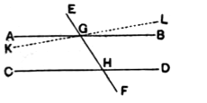

20 But the angles $AGH$, $BGH$ are equal to two right angles; [I. 13]  

therefore the angles $BGH$, $GHD$ are less than two right angles.

But straight lines produced indefinitely from angles less than two right angles meet; [Post. 5]  

25 therefore $AB$, $CD$, if produced indefinitely, will meet;

but they do not meet, because they are by hypothesis parallel.

Therefore the angle $AGH$ is not unequal to the angle $GHD$,

and is therefore equal to it.

30 Again, the angle $AGH$ is equal to the angle $EGB$; [I. 15]  

therefore the angle $EGB$ is also equal to the angle $GHD$. [C. N. 1]

Let the angle $BGH$ be added to each;  

therefore the angles $EGB$, $BGH$ are equal to the 35angles $BGH$, $GHD$. [C. N. 2]

But the angles $EGB$, $BGH$ are equal to two right angles; [I. 13]  

therefore the angles $BGH$, $GHD$ are also equal to two right angles.

Therefore etc. Q. E. D.

---

**23. straight lines produced indefinitely from angles less than two right angles,** αἱ δὲ ἀπ᾽ ἐλασσόνων ἢ δύο ὀρθῶν ἐκβαλλόμεναι εἰς ἄπειρον συμπίπτουσιν, a variation from the more explicit language of Postulate 5. A good deal is left to be understood, namely that the straight lines begin from points at which they meet a transversal, and make with it internal angles on the same side the sum of which is less than two right angles.

**26. because they are by hypothesis parallel,** literally “because they are supposed parallel,” διὰ τὸ παραλλήλους αὐτὰς ὑποκεῖσθαι.

### Proof by "Playfair's" axiom.

If, instead of Postulate 5, it is preferred to use “Playfair's” axiom in the proof of this proposition, we proceed thus.

To prove that the alternate angles $AGH$, $GHD$ are equal.

If they are not equal, draw another straight line $KL$ through $G$ making the angle $KGH$ equal to the angle $GHD$.

Then, since the angles $KGH$, $GHD$ are equal,  
&emsp;&emsp;$KL$ is parallel to $CD$. [I. 27]

Therefore *two straight lines $KL$, $AB$ intersecting at $G$ are both parallel to the straight line $CD$:*  
*which is impossible* (by the axiom).

Therefore the angle $AGH$ cannot but be equal to the angle $GHD$.

The rest of the proposition follows as in Euclid.
