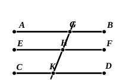

($\alpha$). For anything we know to the contrary, class ($\beta$) may be greater than class ($\alpha$). Hence, if you assert anything of class ($\beta$), the logical effect is more extensive than if you assert it of class ($\alpha$); for you assert it, not only of that portion of class ($\beta$) which is known to be included in class ($\alpha$), but also of the unknown (but possibly existing) portion which is *not* so included.

(2) Euclid's Postulate puts before the beginner clear and *positive* conceptions, a pair of straight lines, a transversal, and two angles together less than two right angles, whereas "Playfair's" axiom requires him to realise a pair of straight lines which never meet though produced to infinity: a *negative* conception which does not convey to the mind any clear notion of the relative position of the lines. And (p. 68) Euclid's Postulate gives a direct criterion for judging that two straight lines meet, a criterion which is constantly required, e.g. in **I.** 44. It is true that the Postulate can be *deduced* from "Playfair's" axiom, but editors frequently omit to deduce it, and then tacitly assume it afterwards: which is the least justifiable course of all.

### PROPOSITION 30.

Straight lines parallel to the same straight line are also parallel to one another.

Let each of the straight lines $AB$, $CD$ be parallel to $EF$;  
I say that $AB$ is also parallel to $CD$.

5For let the straight line $GK$ fall upon them;

Then, since the straight line $GK$ has fallen on the parallel straight lines $AB$, $EF$,  

10the angle $AGK$ is equal to the angle $GHF$. [I. 29]

Again, since the straight line $GK$ has fallen on the parallel straight lines $EF$, $CD$,  

the angle $GHF$ is equal to the angle $GKD$. [I. 29]

15But the angle $AGK$ was also proved equal to the angle $GHF$;  

therefore the angle $AGK$ is also equal to the angle $GKD$; [C. N. 1]

and they are alternate.

20Therefore $AB$ is parallel to $CD$.

Q. E. D.

---

**20.** The usual conclusion in general terms ("Therefore etc.") repeating the enunciation is, curiously enough, wanting at the end of this proposition.

The proposition is, as De Morgan points out, the *logical equivalent* of "Playfair's" axiom. Thus, if $X$ denote "pairs of straight lines intersecting one
