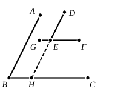
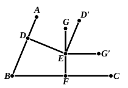

another," $Y$ "pairs of straight lines parallel to one and the same straight line," we have

$$\text{No } X \text{ is } Y,$$

and it follows logically that

$$\text{No } Y \text{ is } X.$$

De Morgan adds that a proposition is much wanted about parallels (or perpendiculars) to two straight lines respectively making the same angles with one another as the latter do. The proposition may be enunciated thus:

*If the sides of one angle be respectively (1) parallel or (2) perpendicular to the sides of another angle, the two angles are either equal or supplementary.*

(1) Let $DE$ be parallel to $AB$ and $GEF$ parallel to $BC$.

To prove that the angles $ABC$, $DEG$ are equal and the angles $ABC$, $DEF$ supplementary.

Produce $DE$ to meet $BC$ in $H$.

Then [I. 29] the angle $DEG$ is equal to the angle $DHC$,  
and the angle $ABC$ is equal to the angle $DHC$.

Therefore the angle $DEG$ is equal to the angle $ABC$; whence also the angle $DEF$ is supplementary to the angle $ABC$.

(2) Let $ED$ be perpendicular to $AB$, and $GEF$ perpendicular to $BC$.

To prove that the angles $ABC$, $DEG$ are equal, and the angles $ABC$, $DEF$ supplementary.

Draw $ED'$ at right angles to $ED$ on the side of it opposite to $B$, and draw $EG'$ at right angles to $EF$ on the side of it opposite to $B$.

Then, since the angles $BDE$, $DED'$, being right angles, are equal,  
$ED'$ is parallel to $BA$. [I. 27]

Similarly $EG'$ is parallel to $BC$.

Therefore [Part (1)] the angle $D'EG'$ is equal to the angle $ABC$.

But, the right angle $DED'$ being equal to the right angle $GEG'$, if the common angle $GED'$ be subtracted,  
the angle $DEG$ is equal to the angle $D'EG'$.

Therefore the angle $DEG$ is equal to the angle $ABC$; and hence the angle $DEF$ is supplementary to the angle $ABC$.

### PROPOSITION 31.

#### *Through a given point to draw a straight line parallel to a given straight line.*

Let $A$ be the given point, and $BC$ the given straight line;  
thus it is required to draw through the point $A$ a straight line parallel to the straight line $BC$.
