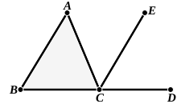

For let $CE$ be drawn through the point $C$ parallel to the straight line $AB$. [I. 31]

Then, since $AB$ is parallel to $CE$,  
and $AC$ has fallen upon them,  

the alternate angles $BAC$, $ACE$ are equal to one another. [I. 29]

Again, since $AB$ is parallel to $CE$,  
and the straight line $BD$ has fallen upon them,  

the exterior angle $ECD$ is equal to the interior and opposite angle $ABC$. [I. 29]

But the angle $ACE$ was also proved equal to the angle $BAC$;  

therefore the whole angle $ACD$ is equal to the two interior and opposite angles $BAC$, $ABC$.

Let the angle $ACB$ be added to each;  

therefore the angles $ACD$, $ACB$ are equal to the three angles $ABC$, $BCA$, $CAB$.

But the angles $ACD$, $ACB$ are equal to two right angles; [I. 13]  

therefore the angles $ABC$, $BCA$, $CAB$ are also equal to two right angles.

Therefore etc. Q. E. D.

---

This theorem was discovered in the very early stages of Greek geometry. What we know of the history of it is gathered from three allusions found in Eutocius, Proclus and Diogenes Laertius respectively.

**1.** Eutocius at the beginning of his commentary on the *Conics* of Apollonius (ed. Heiberg, Vol. II. p. 170) quotes Geminus as saying that “the ancients (οἱ ἀρχαῖοι) investigated the theorem of the two right angles in each individual species of triangle, first in the equilateral, again in the isosceles, and afterwards in the scalene triangle, and later geometers demonstrated the general theorem to the effect that in *any* triangle the three interior angles are equal to two right angles.”

**2.** Now, according to Proclus (p. 379, 2–5), Eudemus the Peripatetic refers the discovery of this theorem to the Pythagoreans and gives what he affirms to be their demonstration of it. This demonstration will be given below, but it should be remarked that it is general, and therefore that the “later geometers” spoken of by Geminus were presumably the Pythagoreans, whence it appears that the “ancients” contrasted with them must have belonged to the time of Thales, if they were not his Egyptian instructors.

**3.** That the truth of the theorem was known to Thales might also be inferred from the statement of Pamphile (quoted by Diogenes Laertius, I. 24–5, p. 6, ed. Cobet) that “he, having learnt geometry from the
