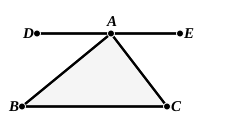

each (sort of) triangle, the equilateral, scalene and isosceles, separately, that each has its angles equal to two right angles, either by one proof or by different proofs, he does not yet know that *the triangle*, i.e. the triangle *in general*, has its angles equal to two right angles, except in a sophistical sense, even though there exists no triangle other than triangles of the kinds mentioned. For he knows it, not *quâ* triangle, nor of *every* triangle, except in a numerical sense (κατ᾽ ἀριθμόν); he does not know it notionally (κατ᾽ εἶδος) of every triangle, even though there be actually no triangle which he does not know.”

The difference between the phrase “used at one time to be proved” in the second illustration and “if any one should prove” in the third appears to indicate that, while the former referred to a historical fact, the latter does not; the reference to a person who should prove the theorem of I. 32 for the three kinds of triangle separately, and then claim that he had proved it generally, states a purely hypothetical case, a mere illustration. Yet, coming after the historical fact stated in the preceding illustration, it might not unnaturally give the impression, at first sight, that it was historical too.

On the whole, therefore, it would seem that we cannot safely go behind the dictum of Eudemus that the discovery and proof of the theorem of I. 32 in all its generality were Pythagorean. This does not however preclude its having been discovered by stages such as those above set out after Hankel and Cantor. Nor need it be doubted that Thales and even his Egyptian instructors had advanced some way on the same road, so far at all events as to see that in an equilateral triangle, and in an isosceles right-angled triangle, the sum of the angles is equal to two right angles.

### The Pythagorean proof.

This proof, handed down by Eudemus (Proclus, p. 379, 2—15), is no less elegant than that given by Euclid, and is a natural development from the last figure in the reconstructed argument of Hankel. It would be seen, after the theory of parallels was added to geometry, that the actual drawing of the perpendicular and the complete rectangle on $BC$ as base was unnecessary, and that the parallel to $BC$ through $A$ was all that was required.

Let $ABC$ be a triangle, and through $A$ draw $DE$ parallel to $BC$. [**I.** 31]  
Then, since $BC$, $DE$ are parallel,  
the alternate angles $DAB$, $ABC$ are equal, [**I.** 29]  
and so are the alternate angles $EAC$, $ACB$ also.

Therefore the angles $ABC$, $ACB$ are together equal to the angles $DAB$, $EAC$.

Add to each the angle $BAC$;  
therefore the sum of the angles $ABC$, $ACB$, $BAC$ is equal to the sum of the angles $DAB$, $BAC$, $CAE$, that is, to two right angles.

### Euclid's proof pre-Euclidean.

The theorem of I. 32 is Aristotle’s favourite illustration when he wishes to refer to some truth generally acknowledged, and so often does it occur that it is often indicated by two or three words in themselves hardly intelligible, e.g. τὸ δυσὶν ὀρθαῖς (*Anal. Post.* I. 24, 85 b 5) and ὑπάρχει παντὶ τριγώνῳ τὸ δύο (*ibid.* 85 b 11).

One passage (*Metaph.* 1051 a 24) makes it clear, as Heiberg (*op. cit.*
