p. 19) acutely observes, that in the proof as Aristotle knew it Euclid's construction was used. "Why does the triangle make up two right angles? Because the angles about one point are equal to two right angles. If then the parallel to the side had been *drawn up* (ἀνῆκτο), the fact would at once have been clear from merely looking at the figure." The words "the angles about one point" would equally fit the Pythagorean construction, but "*drawn upwards*" applied to the parallel to a side can only indicate Euclid's.

### Attempts at proof independently of parallels.

The most indefatigable worker on these lines was Legendre, and a sketch of his work has been given in the note on Postulate 5 above.

One other attempted proof needs to be mentioned here because it has found much favour. I allude to

### Thibaut's method.

This appeared in Thibaut's *Grundriss der reinen Mathematik*, Göttingen (2 ed. 1809, 3 ed. 1818), and is to the following effect.

Suppose $CB$ produced to $D$, and let $BD$ (produced to any necessary extent either way) revolve in one direction (say clockwise) first about $B$ into the position $BA$, then about $A$ into the position of $AC$ produced both ways, and lastly about $C$ into the position $CB$ produced both ways.

The argument then is that the straight line $BD$ has revolved through the sum of the three exterior angles of the triangle. But, since it has at the end of the revolution assumed a position in the same straight line with its original position, it must have revolved through four right angles.

Therefore the sum of the three exterior angles is equal to four right angles; from which it follows that the sum of the three angles of the triangle is equal to two right angles.

But it is to be observed that the straight line $BD$ revolves about *different points in it*, so that there is translation combined with *rotatory* motion, and it is necessary to assume as an axiom that the two motions are independent, and therefore that the translation may be neglected.

Schumacher (letter to Gauss of 3 May, 1831) tried to represent the rotatory motion graphically in a second figure as mere motion round a point; but Gauss (letter of 17 May, 1831) pointed out in reply that he really assumed, without proving it, a proposition to the effect that "If two straight lines (1) and (2) which cut one another make angles $A$, $A''$ with a straight line (3) cutting both of them, and if a straight line (4) in the same plane is likewise cut by (1) at an angle $A'$, then (4) will be cut by (2) at the angle $A''$. But this proposition not only needs proof, but we may say that it is, in essence, the very proposition to be proved" (see Engel and Stäckel, *Die Theorie der Parallellinien von Euklid bis auf Gauss*, 1895, p. 230).

How easy it is to be deluded in this way is plainly shown by Proclus' attempt on the same lines. He says (p. 384, 13–21) that the truth of the theorem is borne in upon us by the help of "common notions" only. "For, if we conceive a straight line with two perpendiculars drawn to it at its extremities, and if we then suppose the perpendiculars to (revolve about their feet and) approach one another, so as to form a triangle, we see that,
