to the extent to which they converge, they diminish the right angles which they made with the straight line, so that the amount taken from the right angles is also the amount added to the vertical angle of the triangle, and the three angles are necessarily made equal to two right angles." But a moment's reflection shows that, so far from being founded on mere "common notions," the supposed proof assumes, to begin with, that, if the perpendiculars approach one another ever so little, they will then form a triangle immediately, i.e., it assumes Postulate 5 itself; and the fact about the vertical angle can only be seen by means of the equality of the alternate angles exhibited by drawing a perpendicular from the vertex of the triangle to the base, i.e. a *parallel* to either of the original perpendiculars.

### Extension to polygons.

The two important corollaries added to I. 32 in Simson's edition are given by Proclus; but Proclus' proof of the first is different from, and perhaps somewhat simpler than, Simson's.

1. *The sum of the interior angles of a convex rectilineal figure is equal to twice as many right angles as the figure has sides, less four.*

For let one angular point $A$ be joined to all the other angular points with which it is not connected already.

The figure is then divided into triangles, and mere inspection shows  
(1) that the number of triangles is two less than the number of sides in the figure,  
(2) that the sum of the angles of all the triangles is equal to the sum of all the interior angles of the figure.

Since then the sum of the angles of each triangle is equal to two right angles the sum of the interior angles of the figure is equal to $2(n - 2)$ right angles, i.e. $(2n - 4)$ right angles, where $n$ is the number of sides in the figure.

2. *The exterior angles of any convex rectilineal figure are together equal to four right angles.*

For the interior and exterior angles together are equal to $2n$ right angles, where $n$ is the number of sides.

And the interior angles are together equal to $(2n - 4)$ right angles.

Therefore the exterior angles are together equal to four right angles.

This last property is already quoted by Aristotle as true of all rectilineal figures in two passages (*Anal. Post.* I. 24, 85 b 38 and II. 17, 99 a 19).

### PROPOSITION 33.

The straight lines joining equal and parallel straight lines (at the extremities which are) in the same directions (respectively) are themselves also equal and parallel.

Let $AB$, $CD$ be equal and parallel, and let the straight  
5 lines $AC$, $BD$ join them (at the extremities which are) in the same directions (respectively);
