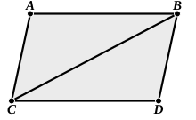

I say that $AC$, $BD$ are also equal and parallel.  
Let $BC$ be joined.

Then, since $AB$ is parallel to $CD$,  
10 and $BC$ has fallen upon them,  

the alternate angles $ABC$, $BCD$ are equal to one another. [I. 29]

And, since $AB$ is equal to $CD$,  
and $BC$ is common,  
15 the two sides $AB$, $BC$ are equal to the two sides $DC$, $CB$;  
and the angle $ABC$ is equal to the angle $BCD$;  

therefore the base $AC$ is equal to the base $BD$,

and the triangle $ABC$ is equal to the triangle $DCB$,

and the remaining angles will be equal to the remaining angles  
20 respectively, namely those which the equal sides subtend; [I. 4]

therefore the angle $ACB$ is equal to the angle $CBD$.

And, since the straight line $BC$ falling on the two straight lines $AC$, $BD$ has made the alternate angles equal to one another,  

25 $AC$ is parallel to $BD$. [I. 27]

And it was also proved equal to it.

Therefore etc. Q. E. D.

---

**1. joining...(at the extremities which are) in the same directions (respectively).** I have for clearness' sake inserted the words in brackets though they are not in the original Greek, which has “joining...in the same directions” or “on the same sides,” ἐπὶ τὰ αὐτὰ μέρη ἐπιζευγνύουσαι. The expression “towards the same parts,” though usage has sanctioned it, is perhaps not quite satisfactory.

**15. DC, CB and 18. DCB.** The Greek has “$BC$, $CD$” and “$BCD$” in these places respectively. Euclid is not always careful to write in corresponding order the letters denoting corresponding points in congruent figures. On the contrary, he evidently prefers the alphabetical order, and seems to disdain to alter it for the sake of beginners or others who might be confused by it. In the case of angles alteration is perhaps unnecessary; but in the case of triangles and pairs of corresponding sides I have ventured to alter the order to that which the mathematician of to-day expects.

This proposition is, as Proclus says (p. 385, 5), the connecting link between the exposition of the theory of parallels and the investigation of parallelograms. For, while it only speaks of equal and parallel straight lines connecting those ends of equal and parallel straight lines which are in the same directions, it gives, without expressing the fact, the construction or origin of the parallelogram, so that in the next proposition Euclid is able to speak of “parallelogrammic areas” without any further explanation.

### PROPOSITION 34.

In parallelogrammic areas the opposite sides and angles are equal to one another, and the diameter bisects the areas.

Let $ACDB$ be a parallelogrammic area, and $BC$ its diameter;
