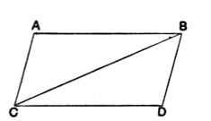

5 I say that the opposite sides and angles of the parallelogram $ACDB$ are equal to one another, and the diameter $BC$ bisects it.

For, since $AB$ is parallel to $CD$,  
and the straight line $BC$ has fallen  
10 upon them,  

the alternate angles $ABC$, $BCD$ are equal to one another. [I. 29]

Again, since $AC$ is parallel to $BD$,  
and $BC$ has fallen upon them,  

15 the alternate angles $ACB$, $CBD$ are equal to one another. [I. 29]

Therefore $ABC$, $DCB$ are two triangles having the two angles $ABC$, $BCA$ equal to the two angles $DCB$, $CBD$ respectively, and one side equal to one side, namely that  
20 adjoining the equal angles and common to both of them, $BC$;  

therefore they will also have the remaining sides equal to the remaining sides respectively, and the remaining angle to the remaining angle; [I. 26]

therefore the side $AB$ is equal to $CD$,

25 and $AC$ to $BD$,

and further the angle $BAC$ is equal to the angle $CDB$.

And, since the angle $ABC$ is equal to the angle $BCD$,  
and the angle $CBD$ to the angle $ACB$,  

the whole angle $ABD$ is equal to the whole angle $ACD$. [C. N. 2]

30 And the angle $BAC$ was also proved equal to the angle $CDB$.

Therefore in parallelogrammic areas the opposite sides and angles are equal to one another.

I say, next, that the diameter also bisects the areas.

For, since $AB$ is equal to $CD$,  
35 and $BC$ is common,  
the two sides $AB$, $BC$ are equal to the two sides $DC$, $CB$ respectively;  
and the angle $ABC$ is equal to the angle $BCD$;  

therefore the base $AC$ is also equal to $DB$,

40 and the triangle $ABC$ is equal to the triangle $DCB$. [I. 4]

Therefore the diameter $BC$ bisects the parallelogram $ACDB$.

Q. E. D.

