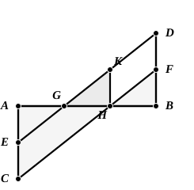

up of straight lines and curves joined together in any manner. It is of course clear that either diagonal of a parallelogram bisects all lines drawn within the parallelogram parallel to the other diagonal.

An-Nairīzī gives after I. 31 a neat construction for dividing a straight line into any number of equal parts (ed. Curtze, p. 74, ed. Besthorn-Heiberg, pp. 141–3) which requires only one measurement repeated, together with the properties of parallel lines including I. 33, 34. As I. 33, 34 are assumed, I place the problem here. The particular case taken is the problem of dividing a straight line into *three* equal parts.

Let $AB$ be the given straight line. Draw $AC$, $BD$ at right angles to it on opposite sides.

An-Nairīzī takes $AC$, $BD$ of the same length and then bisects $AC$ at $E$ and $BD$ at $F$. But of course it is even simpler to measure $AE$, $EC$ along one perpendicular equal and of any length, and $BF$, $FD$ along the other also equal and of the same length.

Join $ED$, $CF$ meeting $AB$ in $G$, $H$ respectively.

Then shall $AG$, $GH$, $HB$ all be equal.

Draw $HK$ parallel to $AC$, or at right angles to $AB$.

Since now $EC$, $FD$ are equal and parallel,  
$ED$, $CF$ are equal and parallel. [I. 33]  
And $HK$ was drawn parallel to $AC$.  
Therefore $ECHK$ is a parallelogram; whence $KH$ is equal as well as parallel to $EC$, and therefore to $EA$.

The triangles $EAG$, $KHG$ have now two angles respectively equal and the sides $AE$, $HK$ equal.  
Thus the triangles are equal in all respects, and  
$AG$ is equal to $GH$.

Similarly the triangles $KHG$, $FBH$ are equal in all respects, and  
$GH$ is equal to $HB$.

If now we wish to extend the problem to the case where $AB$ is to be divided into $n$ parts, we have only to measure ($n - 1$) successive equal lengths along $AC$ and ($n - 1$) successive lengths, each equal to the others, along $BD$. Then join the first point arrived at on $AC$ to the last point on $BD$, the second on $AC$ to the last but one on $BD$, and so on; and the joining lines cut $AB$ in points dividing it into $n$ equal parts.

---

### PROPOSITION 35.

Parallelograms which are on the same base and in the same parallels are equal to one another.

Let $ABCD$, $EBCF$ be parallelograms on the same base $BC$ and in the same parallels $AF$, $BC$;  
5I say that $ABCD$ is equal to the parallelogram $EBCF$.

For, since $ABCD$ is a parallelogram,  
$AD$ is equal to $BC$. [I. 34]
