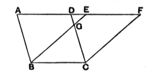

For the same reason also  
$EF$ is equal to $BC$,  

10 so that $AD$ is also equal to $EF$; [C. N. 1]

and $DE$ is common;  

therefore the whole $AE$ is equal to the whole $DF$. [C. N. 2]

But $AB$ is also equal to $DC$; [I. 34]  
therefore the two sides $EA$, $AB$ are equal to the two sides  
15 $FD$, $DC$ respectively,

and the angle $FDC$ is equal to the angle $EAB$, the exterior to the interior; [I. 29]  

therefore the base $EB$ is equal  
20 to the base $FC$,

and the triangle $EAB$ will be equal to the triangle $FDC$. [I. 4]

Let $DGE$ be subtracted from each;  

therefore the trapezium $ABGD$ which remains is equal to the trapezium $EGCF$ which remains. [C. N. 3]

25 Let the triangle $GBC$ be added to each;  

therefore the whole parallelogram $ABCD$ is equal to the whole parallelogram $EBCF$. [C. N. 2]

Therefore etc. Q. E. D.

---

**21. FDC.** The text has “$DFC$.”

**22. Let DGE be subtracted.** Euclid speaks of the triangle $DGE$ without any explanation that, in the case which he takes (where $AD$, $EF$ have no point in common), $BE$, $CD$ must meet at a point $G$ between the two parallels. He allows this to appear from the figure simply.

### Equality in a new sense.

It is important to observe that we are in this proposition introduced for the first time to a new conception of equality between figures. Hitherto we have had equality in the sense of *congruence* only, as applied to straight lines, angles, and even triangles (cf. I. 4). Now, without any explicit reference to any change in the meaning of the term, figures are inferred to be *equal* which are equal in *area* or in *content* but need not be of the *same form*. No *definition* of equality is anywhere given by Euclid; we are left to infer its meaning from the few axioms about “equal things.” It will be observed that in the above proof the “equality” of two parallelograms on the same base and between the same parallels is inferred by the successive steps (1) of subtracting one and the same area (the triangle $DGE$) from two areas equal in the sense of congruence (the triangles $AEB$, $DFC$), and inferring that the remainders (the trapezia $ABGD$, $EGCF$) are “equal”; (2) of adding one and
