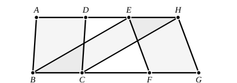

the genesis of unlimited (particulars) within defined limits, so in such theorems the unlimited (particular figures) are confined within defined places or loci (τόποι). And it is this boundary which is the cause of the equality; for the height of the parallels, which remains the same, while an infinite number of parallelograms are conceived on the same base, is what makes them all equal to one another.”

---

### PROPOSITION 36.

Parallelograms which are on equal bases and in the same 
parallels are equal to one another.

Let $ABCD$, $EFGH$ be parallelograms which are on equal bases $BC$, $FG$ and in the same parallels $AH$, $BG$;

I say that the parallelogram $ABCD$ is equal to $EFGH$.

For let $BE$, $CH$ be joined.

Then, since $BC$ is equal to $FG$  
while $FG$ is equal to $EH$,

$BC$ is also equal to $EH$. [C. N. 1]

But they are also parallel. 
And $EB$, $HC$ join them; 
but straight lines joining equal and parallel straight lines (at the extremities which are) in the same directions (respectively) are equal and parallel. [I. 33]

Therefore $EBCH$ is a parallelogram. [I. 34]

And it is equal to $ABCD$; 
for it has the same base $BC$ with it, and is in the same parallels $BC$, $AH$ with it. [I. 35]

For the same reason also $EFGH$ is equal to the same $EBCH$; [I. 35]

so that the parallelogram $ABCD$ is also equal to $EFGH$. [C. N. 1]

Therefore etc. Q. E. D.

