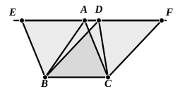

### PROPOSITION 37.

#### *Triangles which are on the same base and in the same parallels are equal to one another.*

Let $ABC$, $DBC$ be triangles on the same base $BC$ and in the same parallels $AD$, $BC$;  
5I say that the triangle $ABC$ is equal to the triangle $DBC$.

Let $AD$ be produced in both directions to $E$, $F$;  
through $B$ let $BE$ be drawn parallel to $CA$, [I. 31]  
10and through $C$ let $CF$ be drawn parallel to $BD$. [I. 31]

Then each of the figures $EBCA$, $DBCF$ is a parallelogram;  
and they are equal,  
15for they are on the same base $BC$ and in the same parallels $BC$, $EF$. [I. 35]

Moreover the triangle $ABC$ is half of the parallelogram $EBCA$; for the diameter $AB$ bisects it. [I. 34]  
And the triangle $DBC$ is half of the parallelogram $DBCF$;  
20for the diameter $DC$ bisects it. [I. 34]  
[But the halves of equal things are equal to one another.]

Therefore the triangle $ABC$ is equal to the triangle $DBC$.

Therefore etc.

Q. E. D.

---

**21.** Here and in the next proposition Heiberg brackets the words “But the halves of equal things are equal to one another” on the ground that, since the Common Notion which asserted this fact was interpolated at a very early date (before the time of Theon), it is probable that the words here were interpolated at the same time. Cf. note above (p. 224) on the interpolated Common Notion.

There is a lacuna in the text of Proclus' notes to I. 36 and I. 37. Apparently the end of the former and the beginning of the latter are missing, the MSS. and the *editio princeps* showing no separate note for I. 37 and no lacuna, but going straight on without regard to sense. Proclus had evidently remarked again in the missing passage that, in the case of both parallelograms and triangles between the same parallels, the two sides which stretch from one parallel to the other may increase in length to any extent, while the area remains the same. Thus the *perimeter* in parallelograms or triangles is of itself no criterion as to their area. Misconception on this subject was rife among non-mathematicians; and Proclus (p. 403, 5 sqq.) tells us (1) of describers of countries (χωρογράφοι) who drew conclusions regarding the size of cities from their perimeters, and (2) of certain members of communistic
