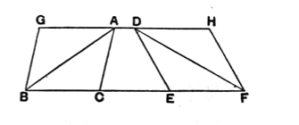

societies in his own time who cheated their fellow members by giving them land of greater perimeter but less area than they took themselves, so that, on the one hand, they got a reputation for greater honesty while, on the other, they took more than their share of produce. Cantor (*Gesch. d. Math.* I₃, p. 172) quotes several remarks of ancient authors which show the prevalence of the same misconception. Thus Thucydides estimates the size of Sicily according to the time required for circumnavigating it. About 130 B.C. Polybius said that there were people who could not understand that camps of the same periphery might have different capacities. Quintilian has a similar remark, and Cantor thinks he may have had in his mind the calculations of Pliny, who compares the size of different parts of the earth by adding their length to their breadth.

The comparison however of the areas of different figures of equal contour had not been neglected by mathematicians. Theon of Alexandria, in his commentary on Book I. of Ptolemy's *Syntaxis*, has preserved a number of propositions on the subject taken from a treatise by Zenodorus περὶ ἰσομέτρων σχημάτων (reproduced in Latin on pp. 1190—1211 of Hultsch's edition of Pappus) which was written at some date between, say, 200 B.C. and 90 A.D., and probably not long after the former date. Pappus too has at the beginning of Book v. of his *Collection* (pp. 308 sqq.) the same propositions, in which he appears to have followed Zenodorus pretty closely while making some changes in detail. The propositions proved by Zenodorus and Pappus include the following: (1) *that, of all polygons of the same number of sides and equal perimeter, the equilateral and equiangular polygon is the greatest in area*, (2) *that, of regular polygons of equal perimeter, that is the greatest in area which has the most angles*, (3) *that a circle is greater than any regular polygon of equal contour*, (4) *that, of all circular segments in which the arcs are equal in length, the semicircle is the greatest*. The treatise of Zenodorus was not confined to propositions about plane figures, but gave also the theorem *that, of all solid figures the surfaces of which are equal, the sphere is the greatest in volume*.

### PROPOSITION 38.

#### *Triangles which are on equal bases and in the same parallels are equal to one another.*

Let $ABC$, $DEF$ be triangles on equal bases $BC$, $EF$ and in the same parallels $BF$, $AD$;  
I say that the triangle $ABC$ is equal to the triangle $DEF$.

For let $AD$ be produced in both directions to $G$, $H$;  
through $B$ let $BG$ be drawn parallel to $CA$, [I. 31]  
and through $F$ let $FH$ be drawn parallel to $DE$.

Then each of the figures $GBCA$, $DEFH$ is a parallelogram;  
and $GBCA$ is equal to $DEFH$;
