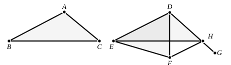

for they are on equal bases $BC$, $EF$ and in the same parallels $BF$, $GH$. [I. 36]

Moreover the triangle $ABC$ is half of the parallelogram $GBCA$; for the diameter $AB$ bisects it. [I. 34]  
And the triangle $FED$ is half of the parallelogram $DEFH$; for the diameter $DF$ bisects it. [I. 34]  
[But the halves of equal things are equal to one another.]

Therefore the triangle $ABC$ is equal to the triangle $DEF$.

Therefore etc.

Q. E. D.

---

On this proposition Proclus remarks (pp. 405—6) that Euclid seems to him to have given in VI. 1 one proof including all the four theorems from I. 35 to I. 38, and that most people had failed to notice this. When Euclid, he says, proves that triangles and parallelograms of the same altitude have to one another the same ratio as their bases, he simply proves all these propositions more generally by the use of proportion; for of course to be of the same altitude is equivalent to being in the same parallels. It is true that VI. 1 generalises these propositions, but it must be observed that it does not prove the propositions themselves, as Proclus seems to imply; they are in fact assumed in order to prove VI. 1.

### Comparison of areas of triangles of I. 24.

The theorem already mentioned as given by Proclus on I. 24 (pp. 340—4) is placed here by Heron, who also enunciates it more clearly (an-Nairīzī, ed. Besthorn-Heiberg, pp. 155—161, ed. Curtze, pp. 75—8).

*If in two triangles two sides of the one be equal to two sides of the other respectively, and the angle of the one be greater than the angle of the other, namely the angles contained by the equal sides, then, (1) if the sum of the two angles contained by the equal sides is equal to two right angles, the two triangles are equal to one another; (2) if less than two right angles, the triangle which has the greater angle is also itself greater than the other; (3) if greater than two right angles, the triangle which has the less angle is greater than the other triangle.*

Let two triangles $ABC$, $DEF$ have the sides $AB$, $AC$ respectively equal to $DE$, $DF$.

(1) First, suppose that the angles at $A$ and $D$ in the triangles $ABC$, $DEF$ are together equal to two right angles.

Heron's construction is now as follows.  
Make the angle $EDG$ equal to the angle $BAC$.  
Draw $FH$ parallel to $ED$ meeting $DG$ in $H$.  
Join $EH$.
