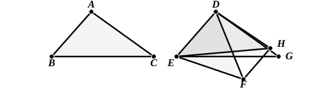
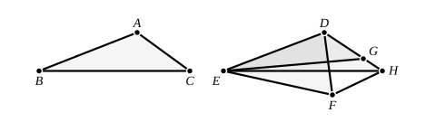

Then, since the angles $BAC$, $EDF$ are equal to two right angles, the angles $EDH$, $EDF$ are equal to two right angles.  
But so are the angles $EDH$, $DHF$.  
Therefore the angles $EDF$, $DHF$ are equal.  
And the alternate angles $EDF$, $DFH$ are equal. [I. 29]  
Therefore the angles $DHF$, $DFH$ are equal,  
and $DF$ is equal to $DH$. [I. 6]  
Hence the two sides $ED$, $DH$ are equal to the two sides $BA$, $AC$; and the included angles are equal.  
Therefore the triangles $ABC$, $DEH$ are equal in all respects.  
And the triangles $DEF$, $DEH$ between the same parallels are equal. [I. 37]  
Therefore the triangles $ABC$, $DEF$ are equal.  
[Proclus takes the construction of Eucl. I. 24, i.e., he makes $DH$ equal to $DF$ and then proves that $ED$, $FH$ are parallel.]

(2) Suppose the angles $BAC$, $EDF$ together less than two right angles.  
As before, make the angle $EDG$ equal to the angle $BAC$, draw $FH$ parallel to $ED$, and join $EH$.

In this case the angles $EDH$, $EDF$ are together less than two right angles, while the angles $EDH$, $DHF$ are equal to two right angles. [I. 29]  
Hence the angle $EDF$, and therefore the angle $DFH$, is less than the angle $DHF$.  
Therefore $DH$ is less than $DF$. [I. 19]

Produce $DH$ to $G$ so that $DG$ is equal to $DF$ or $AC$, and join $EG$.

Then the triangle $DEG$, which is equal to the triangle $ABC$, is greater than the triangle $DEH$, and therefore greater than the triangle $DEF$.

(3) Suppose the angles $BAC$, $EDF$ together greater than two right angles.

We make the same construction in this case, and we prove in like manner that the angle $DHF$ is less than the angle $DFH$,  
whence $DH$ is greater than $DF$ or $AC$.

Make $DG$ equal to $AC$, and join $EG$.

It then follows that the triangle $DEF$ is greater than the triangle $ABC$.

[In the second and third cases again Proclus starts from the construction in I. 24, and proves, in the second case, that the parallel, $FH$, to $ED$ cuts $DG$ and, in the third case, that it cuts $DG$ produced.]
