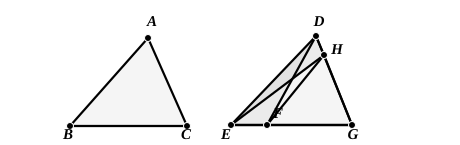

There is no necessity for Heron to take account of the position of $F$ in relation to the side opposite $D$. For in the first and third cases $F$ must fall

in the position in which Euclid draws it in I. 24, whatever be the relative lengths of $AB$, $AC$. In the second case the figure may be as annexed, but the proof is the same, or rather the case needs no proof at all.

---

### PROPOSITION 39.

Equal triangles which are on the same base and on the 
same side are also in the same parallels.

Let ">$ABC$, ">$DBC$ be equal triangles which are on the same base $BC$ and on the same side of it;  
5 [I say that they are also in the same parallels.]  
And [For] let $AD$ be joined;  
I say that $AD$ is parallel to $BC$.

For, if not, let $AE$ be drawn through the point $A$ parallel to the straight line  
10 $BC$, [I. 31]  
and let $EC$ be joined.

Therefore the triangle ">$ABC$ is equal to the triangle ">$EBC$;  
for it is on the same base $BC$ with it and in the same  
15 parallels. [I. 37]

But ">$ABC$ is equal to ">$DBC$;

therefore ">$DBC$ is also equal to ">$EBC$, [C. N. 1] 
the greater to the less: which is impossible.

Therefore $AE$ is not parallel to $BC$.

20 Similarly we can prove that neither is any other straight line except $AD$;

therefore $AD$ is parallel to $BC$.

Therefore etc. Q. E. D.

