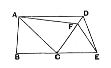

**5. [I say that they are also in the same parallels.]** Heiberg has proved (*Hermes*, xxxviii., 1903, p. 50) from a recently discovered papyrus-fragment (*Fayūm towns and their papyri*, p. 96, No. ix.) that these words are an interpolation by some one who did not observe that the words “And let $AD$ be joined” are part of the *setting-out* (ἔκθεσις), but took them as belonging to the *construction* (κατασκευή) and consequently thought that a διορισμός or “definition” (of the thing to be proved) should precede. The interpolator then altered “And” into “For” in the next sentence.

This theorem is of course the partial converse of I. 37. In I. 37 we have triangles which are (1) on the same base, (2) in the same parallels, and the theorem proves (3) that the triangles are equal. Here the hypothesis (1) and the conclusion (3) are combined as hypotheses, and the conclusion is the hypothesis (2) of I. 37, that the triangles are in the same parallels. The additional qualification in this proposition that the triangles must be *on the same side* of the base is necessary because it is not, as in I. 37, involved in the other hypotheses.

Proclus (p. 407, 4—17) remarks that Euclid only converts I. 37 and I. 38 relative to triangles, and omits the converses of I. 35, 36 about parallelograms as unnecessary because it is easy to see that the method would be the same, and therefore the reader may properly be left to prove them for himself.

The proof is, as Proclus points out (p. 408, 5—21), equally easy on the supposition that the assumed parallel $AE$ meets $BD$ or $CD$ produced beyond $D$.

---

### PROPOSITION 40.

#### *Equal triangles which are on equal bases and on the same side are also in the same parallels.*

Let $ABC$, $CDE$ be equal triangles on equal bases $BC$, $CE$ and on the same side.

I say that they are also in the same parallels.

For let $AD$ be joined;  
I say that $AD$ is parallel to $BE$.

For, if not, let $AF$ be drawn through $A$ parallel to $BE$ [I. 31], and let $FE$ be joined.

Therefore the triangle $ABC$ is equal to the triangle $FCE$;  
for they are on equal bases $BC$, $CE$ and in the same parallels $BE$, $AF$. [I. 38]

But the triangle $ABC$ is equal to the triangle $DCE$;  
therefore the triangle $DCE$ is also equal to the triangle $FCE$, [C. N. 1]  
the greater to the less: which is impossible.

Therefore $AF$ is not parallel to $BE$.
