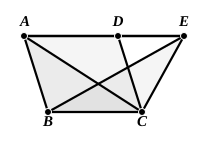

Similarly we can prove that neither is any other straight line except $AD$;

therefore $AD$ is parallel to $BE$.

Therefore etc. Q. E. D.]

---

Heiberg has proved by means of the papyrus-fragment mentioned in the last note that this proposition is an interpolation by some one who thought that there should be a proposition following I. 39 and related to it in the same way as I. 38 is related to I. 37, and I. 36 to I. 35.

---

### PROPOSITION 41.

If a parallelogram have the same base with a triangle and 
be in the same parallels, the parallelogram is double of the 
triangle.

For let the parallelogram $ABCD$ have the same base $BC$ with the triangle $EBC$, and let it be in the same parallels $BC$, $AE$;  
I say that the parallelogram $ABCD$ is double of the triangle $BEC$.

For let $AC$ be joined.

Then the triangle $ABC$ is equal to the triangle $EBC$;  
for it is on the same base $BC$ with it and in the same parallels $BC$, $AE$. [I. 37]

But the parallelogram $ABCD$ is double of the triangle $ABC$; 
for the diameter $AC$ bisects it; [I. 34]

so that the parallelogram $ABCD$ is also double of the triangle $EBC$.

Therefore etc. Q. E. D.

---

On this proposition Proclus (pp. 414, 15—415, 16), “by way of practice” (γυμνασίας ἕνεκα), considers the area of a *trapezium* (a quadrilateral with only one pair of opposite sides parallel) in comparison with that of the triangles in the same parallels and having the greater and less of the parallel sides of the trapezium for bases respectively, and proves that the trapezium is less than double of the former triangle and more than double of the latter.

He next (pp. 415, 22—416, 14) proves the proposition that,

*If a triangle be formed by joining the middle point of either of the non-parallel sides to the extremities of the opposite side, the area of the trapezium is always double of that of the triangle.*
