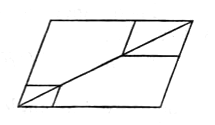
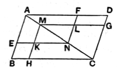

**1. complements**, παραπληρώματα, the figures put in to fill up (interstices).

**4. and about $AC$....** Euclid's phraseology here and in the next proposition implies that the complements as well as the other parallelograms are “about” the diagonal. The words are here περὶ δὲ τὴν ΑΓ παραλληλόγραμμα μὲν ἔστω τὰ ΕΘ, ΖΗ, τὰ δὲ λεγόμενα παραπληρώματα τὰ ΒΚ, ΚΔ. The expression “the so-called complements” indicates that this technical use of παραπληρώματα was not new, though it might not be universally known.

In the text of Proclus' commentary as we have it, the end of the note on I. 41, the whole of that on I. 42, and the beginning of that on I. 43 are missing.

Proclus remarks (p. 418, 15—20) that Euclid did not need to give a formal definition of complement because the name was simply suggested by the facts; when once we have the two “parallelograms about the diameter,” the complements are necessarily the areas remaining over on each side of the diameter, which fill up the complete parallelogram. Thus (p. 417, 1 sqq.) the complements need not be parallelograms. They are so if the two “parallelograms about the diameter” are formed by straight lines drawn through *one* point of the diameter parallel to the sides of the original parallelogram, but not otherwise. If, as in the first of the accompanying figures, the parallelograms have no common point, the complements are five-sided figures as shown.

When the parallelograms overlap, as in the second figure, Proclus regards the complements as being the small parallelograms $FG$, $EH$. But, if complements are strictly the areas required to fill up the original parallelogram, Proclus is inaccurate in describing $FG$, $EH$ as the complements. The complements are really (1) the parallelogram $FG$ *minus* the triangle $LMN$, and (2) the parallelogram $EH$ *minus* the triangle $KMN$, respectively; the possibility that the respective differences may be negative merely means the possibility that the sum of the two parallelograms about the diameter may be together greater than the original parallelogram.

In all the cases it is easy to show, as Proclus does, that the complements are still equal.

---

### PROPOSITION 44.

#### *To a given straight line to apply, in a given rectilineal angle, a parallelogram equal to a given triangle.*

Let $AB$ be the given straight line, $C$ the given triangle and $D$ the given rectilineal angle;  
5 thus it is required to apply to the given straight line $AB$, in an angle equal to the angle $D$, a parallelogram equal to the given triangle $C$.

Let the parallelogram $BEFG$ be constructed equal to the triangle $C$, in the angle $EBG$ which is equal to $D$ [I. 42];  
10 let it be placed so that $BE$ is in a straight line with $AB$; let
