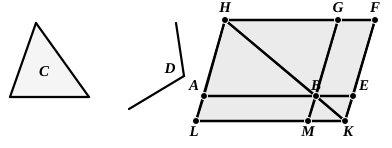

$FG$ be drawn through to $H$, and let $AH$ be drawn through  
$A$ parallel to either $BG$ or $EF$. [I. 31]  
Let $HB$ be joined.

Then, since the straight line $HF$ falls upon the parallels  
15 $AH$, $EF$,  
the angles $AHF$, $HFE$ are equal to two right angles. [I. 29]

Therefore the angles $BHG$, $GFE$ are less than two right angles;  
and straight lines produced indefinitely from angles less than  
20 two right angles meet; [Post. 5]  
therefore $HB$, $FE$, when produced, will meet.

Let them be produced and meet at $K$; through the point  
$K$ let $KL$ be drawn parallel to either $EA$ or $FH$, [I. 31]  
and let $HA$, $GB$ be produced to the points $L$, $M$.

25 Then $HLKF$ is a parallelogram,  
$HK$ is its diameter, and $AG$, $ME$ are parallelograms, and  
$LB$, $BF$ the so-called complements, about $HK$;  
therefore $LB$ is equal to $BF$. [I. 43]

But $BF$ is equal to the triangle $C$;  
30 therefore $LB$ is also equal to $C$. [C. N. 1]

And, since the angle $GBE$ is equal to the angle $ABM$, [I. 15]  
while the angle $GBE$ is equal to $D$,  
the angle $ABM$ is also equal to the angle $D$.

Therefore the parallelogram $LB$ equal to the given triangle  
35 $C$ has been applied to the given straight line $AB$, in the angle  
$ABM$ which is equal to $D$.

Q. E. F.

---

**14. since the straight line $HF$ falls....** The verb is in the aorist (ἐνέπεσεν) here and in similar expressions in the following propositions.

This proposition will always remain one of the most impressive in all geometry when account is taken (1) of the great importance of the result
