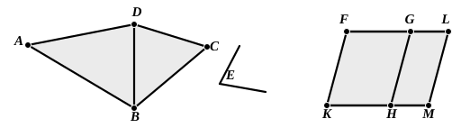

(1) For the *parabola*, the square on the ordinate at any point is equal to a rectangle applied to $p$ as base with altitude equal to the corresponding abscissa. That is to say, with the usual notation,
$$y^2 = px.$$

(2) For the *hyperbola* and *ellipse*, the square on the ordinate is equal to the rectangle applied to $p$ having as its width the abscissa and *exceeding* (for the hyperbola) or *falling-short* (for the ellipse) by a figure similar and similarly situated to the rectangle contained by the given diameter and $p$.

That is, in the *hyperbola*
$$y^2 = px + \frac{x^2}{d^2} pd,$$
or
$$y^2 = px + \frac{p}{d} x^2;$$
and in the *ellipse*
$$y^2 = px - \frac{p}{d} x^2.$$

The form of these equations will be seen to be exactly the same as that of the general equations above given, and thus Apollonius’ nomenclature followed exactly the traditional theory of *application*, *exceeding*, and *falling-short*.

---

### PROPOSITION 45.

To construct, in a given rectilineal angle, a parallelogram 
equal to a given rectilineal figure.

Let $ABCD$ be the given rectilineal figure and $E$ the given rectilineal angle;  
5 thus it is required to construct, in the given angle $E$, a parallelogram equal to the rectilineal figure $ABCD$.

Let $DB$ be joined, and let the parallelogram $FH$ be constructed equal to the triangle $ABD$, in the angle $HKF$ which is equal to $E$; [I. 42]  
10 let the parallelogram $GM$ equal to the triangle $DBC$ be applied to the straight line $GH$, in the angle $GHM$ which is equal to $E$. [I. 44]

Then, since the angle $E$ is equal to each of the angles $HKF$, $GHM$,

15 the angle $HKF$ is also equal to the angle $GHM$. [C. N. 1]

