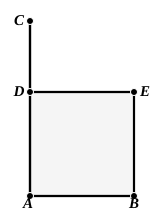

what has been fitly called the *geometrical algebra* of the Greeks. We have now learnt how to represent any rectilineal area, which can of course be resolved into triangles, by a single parallelogram having one side equal to any given straight line and one angle equal to any given rectilineal angle. Most important of all such parallelograms is the rectangle, which is one of the simplest forms in which an area can be shown. Since a rectangle corresponds to the product of two magnitudes in algebra, we see that *application* to a given straight line of a rectangle equal to a given area is the geometrical equivalent of algebraical *division* of the product of two quantities by a third. Further than this, it enables us to *add* or *subtract* any rectilineal areas and to represent the sum or difference by *one* rectangle with one side of any given length, the process being the equivalent of obtaining a common factor. But one step still remains, the finding of a *square* equal to a given rectangle, i.e. to a given rectilineal figure; and this step is not taken till II. 14. In general, the transformation of combinations of rectangles and squares into other combinations of rectangles and squares is the subject-matter of Book II., with the exception of the expression of the sum of two squares as a single square which appears earlier in the other Pythagorean theorem I. 47. Thus the transformation of rectilineal areas is made complete *in one direction*, i.e. in the direction of their simplest expression in terms of rectangles and squares, by the end of Book II. The reverse process of transforming the simpler rectangular area into an equal area which shall be similar to any rectilineal figure requires, of course, the use of proportions, and therefore does not appear till VI. 25.

Proclus adds to his note on this proposition the remark (pp. 422, 24—423, 6): “I conceive that it was in consequence of this problem that the ancient geometers were led to investigate the squaring of the circle as well. For, if a parallelogram can be found equal to any rectilineal figure, it is worth inquiring whether it be not also possible to prove rectilineal figures equal to circular. And Archimedes actually proved that any circle is equal to the right-angled triangle which has one of its sides about the right angle [the perpendicular] equal to the radius of the circle and its base equal to the perimeter of the circle. But of this elsewhere.”

---

### PROPOSITION 46.

On a given straight line to describe a square.

Let $AB$ be the given straight line;  
thus it is required to describe a square on the straight line $AB$.

5 Let $AC$ be drawn at right angles to the straight line $AB$ from the point $A$ on it [I. 11], and let $AD$ be made equal to $AB$;  
through the point $D$ let $DE$ be drawn  
10 parallel to $AB$, and through the point $B$ let $BE$ be drawn parallel to $AD$. [I. 31]
