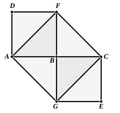

Therefore ">$ADEB$ is a parallelogram;

therefore $AB$ is equal to $DE$, and $AD$ to $BE$. [I. 34]

But $AB$ is equal to $AD$;

15 therefore the four straight lines $BA$, $AD$, $DE$, $EB$ 
are equal to one another;

therefore the parallelogram ">$ADEB$ is equilateral.

I say next that it is also right-angled.  
For, since the straight line $AD$ falls upon the parallels  
20 $AB$, $DE$,

the angles $BAD$, $ADE$ are equal to two right angles. [I. 29]

But the angle $BAD$ is right;

therefore the angle $ADE$ is also right.

And in parallelogrammic areas the opposite sides and  
25 angles are equal to one another; [I. 34]

therefore each of the opposite angles $ABE$, $BED$ is also 
right.

Therefore ">$ADEB$ is right-angled.

And it was also proved equilateral.

30 Therefore it is a square; and it is described on the straight 
line $AB$.

Q. E. F.

---

**1, 3, 30.** Proclus (p. 423, 18 sqq.) notes the difference between the word *construct* (συστήσασθαι) applied by Euclid to the construction of a triangle (and, he might have added, of an angle) and the words *describe on* (ἀναγράφειν ἀπό) used of drawing a square on a given straight line as one side. The triangle (or angle) is, so to say, pieced together, while the describing of a square on a given straight line is the making of a figure “from” one side, and corresponds to the multiplication of the number representing the side by itself.

Proclus (pp. 424—5) proves that, *if squares are described on equal straight lines, the squares are equal; and, conversely, that, if two squares are equal, the straight lines are equal on which they are described*. The first proposition is immediately obvious if we divide the squares into two triangles by drawing a diagonal in each. The converse is proved as follows.

Place the two equal squares ">$AF$, ">$CG$ so that $AB$, $BC$ are in a straight line. Then, since the angles are right, $FB$, $BG$ will also be in a straight line. Join $AF$, $FC$, $CG$, $GA$.

Now, since the squares are equal, the triangles ">$ABF$, ">$CBG$ are equal.

Add to each the triangle ">$FBC$; therefore the triangles ">$AFC$, ">$GFC$ are equal, and hence they must be in the same parallels.
